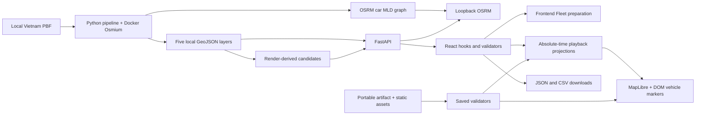

# M0 — Đánh giá kiến trúc hiện tại

> **Historical / Superseded direction (R1b, 19/10/2026):** The current target is Unified Connected NVMR: one connected CAR graph, one independent MOTORBIKE graph, one global engine/fleet/dispatch/clock and unified viewport. Independent N-region R1b expansion is superseded. This historical document retains its original evidence, metrics and limitations; it does not establish cross-province dispatch. See [current implementation](R1B_CONNECTED_IMPLEMENTATION.md), [runbook](R1B_CONNECTED_RUNBOOK.md) and [recovery checkpoint](R1B_PROGRESS.md).

Ngày khảo sát: **15/10/2026 (Asia/Saigon)**. Repository `gsm-map-sandbox`, checkout `feature/nvmr-m0-architecture`, HEAD quan sát `b77ca28240962ac8b6d395e9b522f930a617c80c`. SHA này mô tả snapshot, không phải điều kiện để thực hiện roadmap.

Đọc tiếp: [kiến trúc mục tiêu](M0_TARGET_ARCHITECTURE.md), [kế hoạch M1–M7](M0_IMPLEMENTATION_PLAN.md). Các báo cáo [A1](../A1-report.md), [A2](../A2-report.md), [A3](../A3-report.md), [A4](../A4-report.md), [A5](../A5-report.md) là tài liệu lịch sử; kết quả kiểm tra mới ở mục 9 bên dưới.

## 1. Kết luận và phạm vi bằng chứng

Hệ thống là React/Vite + FastAPI + OSRM local, dùng GeoJSON OSM làm bản đồ. Có thể mở rộng từng bước; chưa có lý do thay framework, chuyển sang microservice hoặc thay toàn bộ engine. Booking đã có một vòng xử lý sự kiện rời rạc đơn giản, có thể phát triển thành worker. Fleet là một luồng khác, chuẩn bị tuyến tại frontend. Voucher tái sử dụng dispatcher Booking, có các bất biến kế toán và pairing đáng giữ lại.

**Giới hạn đã xác nhận từ source:** 1–10 xe; Booking 10–30 booking; Voucher 10–30 potential; một region đang hoạt động và một router car; tối đa 24 điểm candidate từ lưới 6×4. Không có bằng chứng hỗ trợ 5.000 xe, CAR/MOTORBIKE, spatial dispatch hoặc stream trạng thái server.

M0 chỉ thêm ba tài liệu trong `docs/nvmr/`; không sửa source, test, business logic, API, dữ liệu hoặc repository khác. Chỉ dẫn hiện tại của người dùng thay thế các thủ tục Control Kit cũ; không tạo claim, cập nhật ownership, đồng bộ `.nvmr-local`, đổi branch, commit/push/merge hoặc triển khai M1. Bốn file chưa được theo dõi đã tồn tại trước M0 và được giữ nguyên: `docs/evidence/a4.1/dataset-status.json`, `desktop-1440-overview.png`, `desktop-advanced-playing.png`, `desktop-advanced-windowed.png`.

Nhãn sử dụng: **SOURCE CONFIRMED** = đọc implementation; **PASS/FAIL** = lệnh thực chạy; **NOT VERIFIED** = chưa có bằng chứng thực thi cần thiết; **ĐỀ XUẤT** = việc tương lai. PASS fixture không chứng minh routing thật hoặc tính đúng đắn ngoài thực tế.

## 2. Bản đồ module và dependency

Các đường dẫn dưới đây là liên kết tương đối tính từ tài liệu này; tên hàm giúp tìm đúng implementation khi dòng code thay đổi.

| Module | Vai trò thực tế và dependency | Tái sử dụng / lưu ý |
|---|---|---|
| [frontend/package.json](../../frontend/package.json), [vite.config.ts](../../frontend/vite.config.ts) | React 19, TypeScript 6, Vite 8, MapLibre 6, Tailwind 4, Recharts; Vite proxy `/api` tới `127.0.0.1:8000` | Giữ framework và lockfile. Chưa có reverse proxy cho Live production trong repo |
| [App.tsx](../../frontend/src/App.tsx) | Root state bằng React hooks, bốn mode; polling dataset 10 s; abort request khi chọn điểm/mode; Saved bỏ polling | Không thấy Redux/Zustand hoặc persistence DB; HCM vẫn có nhãn/bbox fallback hard-code |
| [api.ts](../../frontend/src/lib/api.ts), [use-booking.ts](../../frontend/src/lib/use-booking.ts), [use-voucher.ts](../../frontend/src/lib/use-voucher.ts) | Fetch, structured error, request cancellation, giữ plan trong memory | Giữ validation trước khi publish plan và bảo vệ stale response |
| [main.py](../../backend/app/main.py) `create_app`, `calculate_route` | FastAPI routes, kiểm tra readiness, shared HTTP client mỗi preparation, semaphore 2 preparation/app instance | POST tính xong toàn bộ rồi trả JSON; không có background job, durable queue, WS/SSE |
| [config.py](../../backend/app/config.py) `Settings`, `Region` | Pydantic Settings, `.env`, bbox/buffer, loopback-only OSRM URL | Region đã là điểm mở rộng tốt nhưng chưa phải registry; map/routing paths cố định |
| [dataset.py](../../backend/app/dataset.py) | Kiểm tra PBF cached verification, map/graph manifest và nearest HTTP probe | Giữ fail-closed. Readiness không phải kiểm chứng graph identity trên router đang chạy |
| [schemas.py](../../backend/app/schemas.py) | Strict WGS84 `[lon,lat]`, positive route metrics, hai snap points | Không có `regionId`, `vehicleType`, profile/version trong route request; extra fields bị từ chối |
| [fleet.py](../../backend/app/fleet.py) `candidate_catalog` | Đọc streets, lưới 6×4, giữ một vertex/cell, shrink bbox 20% mỗi cạnh, manifest fingerprint | Candidate chỉ là anchor OSM, chưa khẳng định car access. Filter loại highway không đủ đại diện xe máy |
| [fleet.ts](../../frontend/src/lib/fleet.ts), [use-fleet.ts](../../frontend/src/lib/use-fleet.ts) | PRNG frontend, OD shuffle, hai route fetch worker Promise, cache session tối đa 100; mỗi xe một chuyến | Giữ cho HCM demo nhỏ; không phải fleet dispatch/worker backend |
| [booking.py](../../backend/app/booking.py) | Models, `demand_inputs`, `LocalTravel`, `build_plan`, validation lifecycle | Lõi tốt để mở rộng. Quét idle toàn bộ; set thời điểm + `min(times)`; scan demand/assignments mỗi thời điểm |
| [voucher.py](../../backend/app/voucher.py) | Fare integer VND half-up, sigmoid booking, paired arms, BudgetLedger, KPI | Giữ pairing, ledger và failure semantics; chưa có mode choice, calibrated behavior hoặc economics đầy đủ |
| [booking.ts](../../frontend/src/lib/booking.ts), [voucher.ts](../../frontend/src/lib/voucher.ts) | Pure projection theo thời gian tuyệt đối; validator; recompute KPI; CSV/JSON export | Seek/reset không phải chạy lại simulation. Backend/frontend cùng định nghĩa KPI nên cần chống drift |
| [fleet-clock.ts](../../frontend/src/lib/fleet-clock.ts), [playback.ts](../../frontend/src/lib/playback.ts), [use-playback.ts](../../frontend/src/lib/use-playback.ts) | Clock RAF cho fleet/booking/voucher, publish khoảng 30 Hz; Single Trip có playback riêng; nội suy theo độ dài geometry | Đây là playback time, không phải server event throughput hay GPS/traffic |
| [sandbox-map.tsx](../../frontend/src/components/sandbox-map.tsx), [map-style.ts](../../frontend/src/lib/map-style.ts) | Một MapLibre map, năm GeoJSON source local, font local, resize/click/error handling | Giữ map lifetime, attribution và WGS84. NVMR cần region-driven style/viewport |
| [fleet-map.tsx](../../frontend/src/components/fleet-map.tsx), [booking-map.tsx](../../frontend/src/components/booking-map.tsx) | DOM marker cho mỗi xe; Fleet vẽ cả background routes, Booking giới hạn pickup marker và vẽ route của selection | Thay đường render xe ở quy mô lớn; giữ selection/focus. Không nên nhân lên 5.000 DOM marker/routes |
| [ui/map.tsx](../../frontend/src/components/ui/map.tsx) | Map/marker/route wrapper, native sources/layers; có sẵn `MapClusterLayer` | Cluster wrapper chưa được Fleet/Booking sử dụng; count font là `Open Sans Semibold`, cần thích ứng font `Geist` local trước tái sử dụng |
| [artifact.ts](../../frontend/src/lib/artifact.ts), [replay-assets.ts](../../frontend/src/lib/replay-assets.ts) | Portable envelope, SHA-256, canonical JSON JS, bounds/semantic validation, immutable imported payload; kiểm tra asset hash | Bộ đọc v1 rất cụ thể cho car/versions/quy mô hiện tại. Giữ nguyên khi thêm v2 |
| [batch.ts](../../frontend/src/lib/batch.ts), [batch-analysis.tsx](../../frontend/src/components/batch-analysis.tsx) | 10/30 seeds, OFAT, tối đa 90 jobs, request tuần tự, timeout 120 s, compact cache 90; xuất lỗi/hủy cùng kết quả | Có paired seed summary, chưa phải server batch job hoặc confidence interval cho dữ liệu thật |
| [pipeline.py](../../scripts/pipeline.py), [render_data.py](../../scripts/render_data.py) | Docker Osmium verify/extract/render; OSRM extract/partition/customize MLD; manifests, hash, refuse overwrite | Hard-code `hcm-center`, `/opt/car.lua`, container/port; CLI có `--region-config` nhưng đổi file chưa đủ để có multi-region |
| [contracts/](../../contracts/), [package-replay.mjs](../../frontend/scripts/package-replay.mjs), [verify-replay.mjs](../../frontend/scripts/verify-replay.mjs) | Handoff/static asset manifests, đóng gói demo, offline replay checks | Handoff WP3 là tài liệu/contract riêng, không chứng minh đã tích hợp repo khác |

## 3. Kiến trúc và năm luồng dữ liệu

### 3.1. Khởi tạo và vị trí phương tiện

Single Trip: `App` chọn A/B → `/api/route` → geometry + duration → `usePlayback`/`positionAt` → marker trên route. Không có booking trong luồng này.

Fleet: `/api/fleet/candidates` → `scenarioInputs(seed,fingerprint,count)` → frontend fetch `/api/route` bằng hai worker Promise → `validateFleetRoute` → `FleetScenario` → `FleetClock` → `vehicleAt`/`fleetPosition`. Trạng thái `scheduled/moving/completed`; departure offset 0–44 s; không gọi routing trong playback. Đây là demo các chuyến độc lập, không tái phân công xe.

Booking: `demand_inputs` chọn vehicle anchors và arrivals từ candidate catalog; `build_plan` gọi nearest để snap xe, giữ `vehicles[id]={position,active}`. Backend chỉ cập nhật position tới điểm trả khi hoàn tất; vị trí khi chạy do frontend nội suy pickup/trip route. Không mô phỏng ùn tắc, dwell, pin/sạc hoặc vị trí GPS thật.

### 3.2. Booking → dispatch → hoàn tất

`POST /api/booking-simulation/prepare` → validate `PrepareRequest` → readiness → semaphore → `LocalTravel` + `build_plan`. Arrivals và deadline tạo tập thời điểm. Vòng lặp lấy thời điểm nhỏ nhất, giải phóng xe hoàn tất, phát pickup/start, nhận demand, FIFO dispatch và expire pending. Voucher dùng thêm callback để xử lý pending/deadline trước arrivals cùng thời điểm, bảo toàn thứ tự ledger.

Với mỗi booking pending: sort idle IDs → lấy trip route → OSRM Table từ **mọi idle vehicle** tới snapped pickup → xếp ETA/vehicle ID → thử pickup route đầy đủ theo thứ tự → xác nhận continuity và pickup trước deadline → nhận xe đầu tiên hợp lệ. Đó là minimum **Table** ETA với full-route confirmation; không chứng minh minimum full-route ETA trên mọi xe. Null Table ETA bị loại; lỗi 422 có thể thành unserved tại deadline, lỗi dịch vụ 5xx làm preparation thất bại.

Lifecycle: `BOOKING_REQUESTED → BOOKING_ASSIGNED → VEHICLE_ARRIVED_PICKUP → TRIP_STARTED → TRIP_COMPLETED`, hoặc `BOOKING_REQUESTED → BOOKING_UNSERVED`. Validators kiểm tra timestamp, overlap xe, terminal demand, event order. `pickupRoute=null` chỉ dành cho xe đã ở pickup đã snap (<0,1 m); không tạo tuyến zero-length giả. `horizonSeconds` là cửa sổ arrival; hệ thống drain đến kết thúc demand đã chấp nhận, không ép mọi chuyến hoàn thành trước horizon.

### 3.3. Route → OSRM → ETA

`calculate_route`: kiểm tra bbox routing và hai điểm khác nhau; PBF verification/graph manifest → `/route/v1/driving/...`, `overview=full`, GeoJSON, `radiuses=max_snap_meters` → kiểm tra LineString, positive metrics, hai snap, khoảng cách snap, endpoint continuity và toàn bộ geometry trong routing bbox. Không có fallback public router hoặc đường thẳng. `LocalTravel.route` còn bắt geometry nằm trong **display bbox**, chặt hơn Single Trip; tuyến vòng ra ngoài display hiện bị loại dù graph buffer có đường.

`LocalTravel` có cache route/table trong memory một preparation, nearest/table/route counts; dùng chung instance qua hai arm. Kết quả route thuần có thể dùng chung, trạng thái xe/ledger không dùng chung. URL `/driving` không tự định nghĩa profile: graph được dựng bằng `/opt/car.lua`. Duration là ước tính car profile tĩnh, không phải thời gian ùn tắc hoặc ETA đã hiệu chuẩn.

### 3.4. Voucher → paired outcomes → KPI/export

`ExperimentRequest` → một `core_config` → một potential population và initial fleet → prequote route/fare cho potential → draw chung `SHA256(price-response-v1,seed,fingerprint,passengerId)` 53 bit → chạy Baseline rồi Treatment qua `build_plan` với callback quyết định tại arrival. Baseline discount/budget bằng 0. Treatment eligibility là min fare + fixed/percentage/cap + ngân sách còn lại; discount đầy đủ hoặc 0.

`p(book)=sigmoid(alpha-beta*(fare-discount)/referenceFare)`; đồng nhất alpha/beta theo config, chưa hiệu chuẩn. `accepted=(draw<p)` sinh booking riêng mỗi arm; số booking khác nhau là kết quả hợp lệ của mô hình. Không có assignment/completion uplift hằng số. Tuy nhiên giả định beta≥0 đã quy định phản ứng giá không giảm khi giảm giá; không thể dùng kết quả để tuyên bố đã phát hiện thực nghiệm hành vi GSM.

Ledger: OFFERED không tiêu tiền → RESERVED lúc accept → SETTLED khi completion hoặc RELEASED khi unserved; không nâng voucher hồi tố sau khi ngân sách được trả lại. `arm_metrics`/`experimentMetrics` tính từ events/assignments/ledger; final dùng chung `max(config horizon, duration hai arm)`. CSV có summary/decisions/bookings/ledger/series; legacy JSON là payload, portable JSON có envelope + integrity. Batch dùng cùng ordered seeds trong các nhóm factor; chỉ successful pairs vào statistic, vẫn lưu errors/cancelled.

### 3.5. Backend → map và Saved runtime

Hiện không truyền delta theo tick. Backend trả toàn bộ plan có route geometry, events, candidates, provenance; hooks validate rồi lưu trong memory. `BookingMap` recompute `bookingProjection(time)`, dùng DOM marker; Voucher chọn một arm để chiếu lên map, không trộn state hai arm. Chart/KPI có playback view và final view.

Saved chỉ tải static assets/portable file → checksum + semantic validation → asset manifest/bbox/fingerprint match → publish immutable session → dùng chung clock/projections. Không cần FastAPI/OSRM. Persistence là file tải xuống và assets trên disk; không có account DB, autosave session hay durable simulation jobs trong implementation được khảo sát.

## 4. HCM cần bảo toàn và hợp đồng dữ liệu

| Luồng | Hành vi/contract giữ nguyên | Test hiện có và khoảng trống |
|---|---|---|
| Single Trip | POST `/api/route` chỉ `{start,end}`; `[lon,lat]`, m/s, snap/error codes; pause/seek/reset; không fake route | `test_backend.py`, `test_a1.py`, `playback.test.ts`; live OSRM/WebGL chưa xác minh lượt này |
| Fleet | GET candidates, seeded inputs ≤10, partial failures có reason, cache theo fingerprint, không route lúc replay | `test_a2.py`, `fleet.test.ts`; chưa có benchmark nghìn xe |
| Booking | POST prepare, `ScenarioPlan`/events/assignment references, FIFO, ID tie, inclusive max wait, null stationary pickup | `test_a3.py`, `booking.test.tsx`; cần shortlist oracle, out-of-order job/cancellation và event queue equivalence ở M3 |
| Voucher | POST prepare, potential chung, vehicles chung, state riêng, zero discount parity, accounting và null denominator | `test_a4.py`, `voucher.test.tsx`, `dashboard.test.tsx`; chưa test mode choice, routing theo mode, policy space/time |
| Saved/exports | `gsm-voucher-experiment/v1`, `gsm-replay-assets/v1`, JS canonicalization `gsm-json-sorted/v1`, checksum/semantic validation và CSV column/unit semantics | `artifact.test.ts`, `saved-replay.test.ts`, `batch.test.ts`; cần fixtures v1 tồn tại song song v2, cross-region import và base-path production QA |
| Product shell | Một map/clock cho mode hiện hành, cleanup, responsive inspector, tiếng Việt, Saved không gọi `/api` | `workspace.test.tsx`, `localization.test.tsx`; jsdom không chứng minh WebGL/GPU performance |

Đặc biệt: portable v1 chặn profile khác `car`/algorithm khác `mld`, model versions phải khớp chính xác; giới hạn 12 MiB input, 200.000 tổng route points, 512 timeSeries rows, 10 vehicles/30 potential. Không chỉ tăng `fleetSize` trong Python rồi coi NVMR tương thích. Legacy A4 JSON hiện cần chuyển đổi tường minh bằng packaging/export; không tuyên bố Saved đang nhận trực tiếp mọi legacy file. Không đổi byte/schema/ID asset HCM hiện có để nhét NVMR.

## 5. Hard-code và rủi ro mở rộng

| Vị trí | Giới hạn/ảnh hưởng | Hướng xử lý tương lai |
|---|---|---|
| `config/region.json` | Technical bbox `[106.675,10.750,106.725,10.795]`, buffer 0,015°, không phải boundary hành chính | Registry, region identity, coverage và sampling riêng |
| `Settings.map_path/routing_dir`, `dataset.GRAPH_FILES`, pipeline | `data/processed/render`, `data/routing`, `hcm-center.*`, `gsm-map-osrm`, port 5000; readiness bắt car | Namespace region/profile/artifact, giữ legacy HCM resolver |
| `App.tsx`, `sandbox-map.tsx`, default seeds/panels | HCM headings, labels, fallback bbox/zoom; Saved khởi đầu dùng HCM fallback | Metadata region trên session/asset, viewport update tường minh khi đổi region |
| `candidate_catalog` | ≤24 anchors, một số highway classes, shrink 20%; fleet cần anchors ≥fleetSize | Sampling có trọng số theo vùng, cho phép nhiều xe cùng depot/anchor; mode-specific snap validation |
| `build_plan` | `min(set times)`, scan assignments/demand, sort FIFO, Table toàn idle; chờ HTTP tuần tự | Heap events, indices, spatial shortlist, bounded concurrency và deterministic commit |
| `arm_metrics`, `timeSeries` | Mỗi timestamp quét lại history/ledger; full routes lặp trong potential/arms/assignments | Incremental accumulators, route store tham chiếu, snapshot/checkpoint |
| `bookingProjection`, `fleetPosition` | Mỗi frame scan events và assignments theo mỗi vehicle; segment traversal tuyến tính; publish ~30 Hz | Indices/checkpoints, cumulative distance + binary search nếu đo thấy cần, tách map updates khỏi chart |
| Map + basemap | DOM marker/xe, Fleet background route/xe; năm GeoJSON toàn vùng; render pipeline cap 64 MiB | Native layers, selected routes; đo Hà Nội nhỏ trước, tiles chỉ khi dữ liệu đo cho thấy cần |
| Concurrency/deployment | Semaphore 2 chỉ trong một app process; request dài, client disconnect; loopback validator chặn Docker hostname | Một worker process ban đầu, bounded queue/jobs; registry endpoint nội bộ do operator cấu hình, không URL từ user |
| Reproducibility | Dataset fingerprint có URL/threshold/bbox và streets hash; đổi port có thể đổi fingerprint và demand/draw dù graph giữ nguyên | v2 tách content identity khỏi runtime endpoint, giữ thuật toán v1 cho replay cũ |
| Provenance | Readiness kiểm tra file size/bbox/manifest, PBF path/size/mtime; không hash graph mỗi request hoặc xác minh service identity | Offline content verification + startup graph identity probe, provenance đầy đủ profile dependencies |

Các dòng trên là rủi ro từ source; chưa phải số đo latency/memory. Tăng TOTAL FLEET không đồng nghĩa tăng xe moving; hiện chưa có OFFLINE/ONLINE nên không thể suy ra KPI availability từ trạng thái playback Fleet.

## 6. Audit khoa học Voucher

| Điều kiện | Phân loại | Bằng chứng/giới hạn |
|---|---|---|
| Cùng potential/initial fleet, quyết định tạo booking riêng | ĐÃ CÓ — source + fixture PASS | `prepare_experiment`, `build_plan(inputs,initial)` deep copy; test pairing/zero-discount |
| Controlled random draws | ĐÃ CÓ trong v1 | `demand-v1` counter SHA cho arrivals/OD; keyed passenger draw cho behavior, không có draw theo arm; ordering deterministic. Chưa có nhiều stream mode/service choice |
| Zero voucher Baseline, zero-effect parity | ĐÃ CÓ — fixture PASS | Các control zero budget/fixed/rate/minimum fare; không buộc completion uplift |
| State/ledger isolation | ĐÃ CÓ — source + fixture PASS | Mỗi arm tạo vehicles/pending/ledger riêng; shared travel cache chỉ chứa routing evidence. Chưa chạy arm-reversal integration với router thật |
| Đúng accounting | ĐÃ CÓ trong tested paths | VND integer half-up; reserve/settle/release once; `gross=riderPayments+voucherSpend`, available≥0, terminal reservations=0 |
| KPI final/playback | ĐÃ CÓ với định nghĩa cụ thể | Conversion=accepted/valid potential; completion=completed/accepted; wait chỉ picked, ETA chỉ assigned; utilization=(pickup+occupied busy)/(all vehicles×common final time), không phải online-only/occupied-only |
| Tái lập một run | MỘT PHẦN | Seed/config/model versions/fingerprint/provenance có; `createdAt`, preparation time/cache counters có thể khác. Model identity không phải content hash toàn bộ execution, chưa pin source commit trong payload |
| Routing/data provenance đầy đủ | MỘT PHẦN | Extract/streets/profile SHA, image digest, algorithm, bbox/threshold có. Profile Lua dependencies, graph checksums toàn bộ, endpoint identity chưa đầy đủ; shared mutable service phải bất biến trong run |
| CAR/MOTORBIKE, no-book vs mode choice | CHƯA CÓ | Một mode car, một fare/behavior; không có choice utility hoặc availability theo mode |
| Demand uplift/spatial change | MỘT PHẦN | Voucher thay acceptance trên fixed potential, đã có booking uplift; chưa thêm population vì policy, OD redistribution/heterogeneity/targeted zone policy hoặc đo induced vs switched mode |
| Incremental economics | MỘT PHẦN | Settled subsidy và CPIC khi Δcompleted>0; null nếu ≤0. Chưa có chi phí/km/giờ, margin hoặc ROI; doanh thu gộp không phải lợi nhuận |
| Thống kê nhiều seeds | ĐÃ CÓ giới hạn PoC | Mean/median/sample SD, empirical distribution, pooled spend/sum(all increments); lỗi/hủy không thay bằng 0. Không phải ước lượng nhân quả dữ liệu thật |
| Hiệu chuẩn, GSM operational validity | NOT VERIFIED / chưa có dữ liệu trong luồng này | Roads từ OSM, ETA từ OSRM; demand/price response/fare/voucher là synthetic/model-based. Không xác nhận commercial effect, observed elasticity hoặc production readiness |

Cần giữ các null và failure reasons. Hai arm có số booking/trip khác nhau là bình thường; không ép pairing trên outcome count. Thay mode choice/ETA vào behavior là thay mô hình khoa học và cần version mới, kiểm chứng riêng; không sửa sigmoid v1 để làm biểu đồ đẹp hơn.

## 7. Region và ranh giới dữ liệu

Region hiện tại tự khai là bbox kỹ thuật, không boundary Quận 1 hành chính. NVMR nên bắt đầu bằng coverage Hà Nội rõ ràng, sau đó mở rộng; danh sách địa phương là yêu cầu phạm vi nghiên cứu, chưa phải một tập OSM relation đã được kiểm chứng.

Cần phân biệt tên trước/sau sắp xếp: nguồn chính thức về [Nghị quyết 202/2025/QH15](https://xaydungchinhsach.chinhphu.vn/toan-van-nghi-quyet-so-202-2025-qh15-ve-sap-xep-don-vi-hanh-chinh-cap-tinh-119250612174148722.htm) và [danh sách đơn vị sau sắp xếp](https://xaydungchinhsach.chinhphu.vn/chi-tiet-34-don-vi-hanh-chinh-cap-tinh-tu-12-6-2025-119250612141845533.htm) cho thấy tên tỉnh hiện nay có thể bao gồm nhiều tỉnh trước đây; Hải Dương trước đây thuộc phạm vi Hải Phòng sau sắp xếp. Đây chỉ là cảnh báo về identity, không dùng tên mới để tự mở rộng toàn bộ study area. OSM relation IDs/versions/polygons, thời điểm snapshot và coverage mong muốn **NOT VERIFIED** ở M0; M1 phải ghi explicit mapping và kiểm tra geometry. Không tải GIS/graph miền Bắc trong M0.

## 8. Khởi chạy và deployment hiện tại

Theo [README](../../README.md), [scripts khởi chạy](../../scripts/start-backend.ps1) và pipeline: Python venv + locked requirements, Node/npm lock; Docker Linux Engine cho Osmium/OSRM và local PBF/GeoJSON/graph đã chuẩn bị. Live dùng backend port 8000, frontend Vite port 5173, OSRM loopback 5000; scripts giữ cwd theo project root. Không thấy Docker Compose, Dockerfile app, CI workflow hoặc persistent DB trong checkout khảo sát. Docker commands nằm trong Python pipeline, pin OSRM image tag và ghi resolved digest vào manifest.

Saved dùng `package:replay`, `verify:replay`, build frontend rồi `scripts/serve_replay.py` port 4173; chỉ static, chặn `/api`. Script server này append log vào `docs/evidence/a5/static-requests.jsonl`; M0 không chạy để tránh làm đổi evidence cũ. Packaging có ghi assets/manifests; M0 chỉ verify gói sẵn, không tái tạo gói.

Portability risks: source-verification giữ absolute path/mtime; copy PBF sang máy mới cần verify lại; pipeline Docker mount chỉ chấp nhận PBF trong project root; `.venv/Scripts` và npm.cmd là Windows-specific wrappers; image digest/lock/dependency/runtime cần đồng bộ khi chuyển máy. Data và public replay/worker/dist bị Git ignore nên clone repo không tự có runtime assets. Loopback HTTP validator phù hợp host process hiện tại nhưng không nhận `http://osrm-car:5000` trong Compose. Server deployment cần same-origin `/api` proxy, job timeout/resource limits, controlled artifact paths và private routing network, không chỉ `vite preview`.

## 9. Verification thực chạy

Chạy ngày 15/10/2026, trên checkout nêu trên. Không coi historical screenshots/reports là kết quả kiểm tra mới.

| Lệnh / check | Kết quả thực tế | Phạm vi |
|---|---|---|
| `.\.venv\Scripts\python.exe -m pytest -q` (root) | **PASS: 122 passed, 5 skipped**, 10,67 s; 1 Starlette/httpx TestClient deprecation warning | Fixture/unit/API contracts; 5 opt-in real-data tests không chạy |
| `npm.cmd test` (`frontend`) | **PASS: 140 tests, 10 files**, 10,57 s | Vitest/jsdom; không WebGL |
| `npm.cmd run lint` (`frontend`) | **PASS exit 0**, 16 warnings | React effect/ref/fast-refresh warnings đang có; không đồng nghĩa warning-free |
| `npm.cmd run build` (`frontend`) | **PASS exit 0**, TypeScript build + Vite production | Có chunk >500 kB warning; main JS ~1.423 kB minified, ~402 kB gzip. Không chứng minh FPS |
| `npm.cmd run verify:replay` (`frontend`) | **PASS: package, 9 assets**, `browserExports=NOT_RUN` | Digest demo `b4a87ee371f976f12f4da28791dffc66ebeb24352c1d664bf71851eb89c27433`; validate existing artifact/hash assets, không fresh browser export |
| `dataset_status(Settings())` + `candidate_catalog` bằng Python | `ready=false`, `pbf=present_verified`, `map_ready=true`, `graph_built=true`, `graph_ready=false`, router unavailable, 24 candidates | Manifest/metadata + HTTP probe; không hash lại toàn bộ PBF/graph |
| `docker ps --format ...` | **FAIL môi trường:** không kết nối named pipe `dockerDesktopLinuxEngine` | Docker CLI có, Linux Engine không hoạt động; không tự khởi động/đổi container |
| HCM live route/booking/voucher + visual browser smoke | **NOT VERIFIED** | OSRM không chạy; không chạy UI/WebGL lượt này |
| NVMR CAR/MOTORBIKE / 100–5.000 xe | **NOT VERIFIED** | Chưa triển khai, chưa tạo artifacts/benchmark |

Metadata assets hiện có: 8.268.935 bytes cho năm render layers (streets 15.281 features; water 124; green 471; buildings 12.785; places 93), graph manifest `car/mld`, tổng artifact sizes 20.925.168 bytes. Đây là kích thước file/metadata HCM, **không phải RAM, tải NVMR hay bằng chứng capacity**.

Kiểm tra tài liệu sau khi viết: ba file Markdown đọc UTF-8 hợp lệ, không replacement character/trailing whitespace, code fences cân bằng, mọi liên kết local tồn tại — **PASS**. `git diff --check` — **PASS**; `git diff --name-only` rỗng cho tracked files; `git status --short` chỉ có ba tài liệu M0 mới và bốn file evidence untracked đã tồn tại. Không thêm regression test vì không đổi implementation; build/verifier chỉ sinh các output đã được Git ignore (`dist`, worker assets, `.replay-tools`). Không stage/commit/push.

Để xác minh lại live sau: operator khởi Docker Linux Engine và đúng HCM router đã có, xác nhận `/api/dataset/status.ready=true`, rồi trong PowerShell từ root chạy `$env:RUN_REAL_DATA='1'; .\.venv\Scripts\python.exe -m pytest -q` và khôi phục giá trị env trước đó. Năm test opt-in nằm ở `test_a1.py` (2), `test_a2.py` (1), `test_a3.py` (1), `test_a4.py` (1). Đọc trước `test_real_geojson_and_protected_inputs`: có kiểm tra hash input ngoài repository theo preflight A1 lịch sử; thiếu input đó phải báo riêng, không tạo evidence giả. Tiếp theo chạy browser QA bốn mode và Saved khi backend/OSRM tắt, kiểm tra import/export/seek và network isolation.

## 10. Ưu tiên sau audit

1. M1: region identity + paths/endpoints + compatibility tests HCM, rồi Hanoi core với dữ liệu được xác minh. Chưa cần worker để mở thí nghiệm nhỏ.
2. M2: explicit mode contracts và motorbike profile validation độc lập; không dùng car/bicycle route thay xe máy.
3. M5/M6 nhỏ: giữ potential chung, thêm service choice/versioned artifacts và nghiên cứu end-to-end Hà Nội; chạy song song việc scale M3/M4 khi dependencies phù hợp.
4. M3/M4: benchmark riêng simulation, router và map trước khi công bố hỗ trợ 5.000 xe. M7 đưa pipeline đã kiểm chứng lên một máy chủ với hạ tầng tối thiểu.
