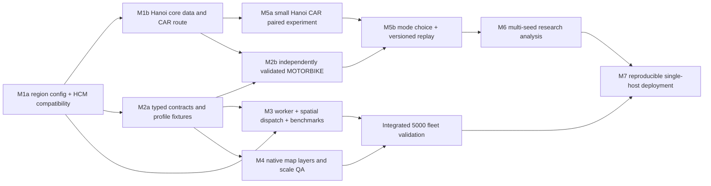

# M0 — Kế hoạch triển khai M1–M7

Ngày: 15/10/2026. **Kế hoạch đề xuất, chưa triển khai milestone tiếp theo.** Căn cứ: [audit source và verification](M0_ARCHITECTURE_ASSESSMENT.md), [kiến trúc mục tiêu](M0_TARGET_ARCHITECTURE.md). Kế hoạch dùng checkout hiện tại làm điểm xuất phát, không yêu cầu claim/ownership board, fixed SHA hay branch-specific gate.

## 1. Thứ tự đem lại end-to-end sớm

Ưu tiên một thí nghiệm nhỏ tái lập được tại Hà Nội trước khi tối ưu toàn bộ 5.000 xe. Các milestone là nhóm năng lực, không phải chuỗi phê duyệt hành chính. File mới bên dưới là **dự kiến**, không khẳng định đã tồn tại.

M5a dùng behavior car v1 và config Hà Nội sau M1 để kiểm tra pipeline, giữ giới hạn nhỏ; chưa gọi đó là nghiên cứu multimodal. M3/M4 có thể phát triển bằng fixtures song song với chuẩn bị dữ liệu/profile. M7 packaging/runbook có thể làm sớm; chỉ tuyên bố từng capability khi có kiểm tra tương ứng, không cần chặn deploy pilot vì chưa đạt 5.000 xe.

## 2. M1 — Region configuration và Hanoi core

**Mục tiêu:** chọn region/dữ liệu/router đúng một cách tường minh, giữ nguyên default HCM. Có luồng Hanoi Single Trip → Booking nhỏ → Voucher CAR nhỏ.

**Công việc kỹ thuật**

1. M1a thêm typed registry/region resolver, public region capabilities/readiness; giữ `Settings` legacy HCM và paths hiện tại làm default. Tách display/operating/routing/render coverage, region-driven labels/viewport, cancel stale requests khi đổi region.
2. Thêm API version mới hoặc adapter riêng cho region-explicit request; không gửi `regionId` vào `RouteRequest` v1 đang `extra=forbid`. Endpoint `/api/route` cũ vẫn hiểu đúng `{start,end}` và structured errors hiện tại.
3. Pipeline nhận region/profile output namespace và container/service identity, không còn suy tên artifact từ `hcm-center`. Có dry-run, reuse theo manifest/config hash và refuse-overwrite. Chưa đổi artifact HCM hiện hữu.
4. M1b lập coverage Hà Nội nhỏ và snapshot source; kiểm tra technical polygon/bbox/buffer, route đi vòng, OSM relation nếu dùng. Ghi mapping tên cũ/mới, hash/license/snapshot và những vùng chưa có. Chọn dữ liệu sẵn có phù hợp hoặc chuẩn bị extract có chủ đích sau khi scope dữ liệu rõ; đây là việc M1, không thực hiện trong M0.
5. Dựng và xác minh CAR graph/render/candidate package Hà Nội trong namespace mới; candidate sampling không còn phụ thuộc hoàn toàn lưới demo 24 anchors. Kiểm tra operating points, snaps và connectivity độc lập với việc render đường đẹp.

**Module dự kiến tác động:** `backend/app/config.py`, `dataset.py`, `fleet.py`, `main.py`, `schemas.py`; mới `backend/app/regions.py`, `config/regions/*.json`; `scripts/pipeline.py`, `render_data.py`; `frontend/src/App.tsx`, `lib/api.ts`, `map-style.ts`, `components/sandbox-map.tsx`; tests A1/A2 và frontend workspace/fleet. `config/region.json` và paths HCM cũ được giữ thông qua resolver tương thích.

**Phụ thuộc thực:** source/coverage Hà Nội có provenance; Docker Linux Engine + image/graph CAR cho live integration; fixture work không cần router thật. Thực tế lượt M0: Docker Engine/OSRM unavailable, cần khôi phục trước M1b live checks.

**Rủi ro:** tên tỉnh không tương ứng polygon mong muốn; graph quá hẹp; route loop ra ngoài display bị từ chối theo legacy rule; assets lẫn region; đổi endpoint làm đổi fingerprint/demand v1; cached response của region trước ghi vào region mới.

**Hoàn thành và kiểm thử:**

- Default không truyền region giữ HCM route/booking/voucher contracts và old replay. Fixture parity source inputs/semantic results; unknown region lỗi rõ, không fallback HCM.
- Hai region resolve paths/assets/router riêng; đổi selection trong lúc request chậm không publish stale state, không tạo thêm map/clock.
- Real directed OD suite ở Hanoi core: route success, NoSegment/NoRoute, snap threshold, boundary/coverage, full geometry và positive metrics; không có line fallback. Lưu source/graph manifest và command logs mới.
- Smoke HCM cả bốn mode; Saved cũ chạy không backend/OSRM. Smoke Hanoi CAR small booking/voucher và export/import ở contract phù hợp. Nếu chưa có asset package Hanoi cho Saved thì ghi rõ phần đó chưa hoàn tất, không dùng HCM manifest thay thế.

**Kết quả:** region registry và Hanoi CAR pilot có evidence, HCM behavior ổn định; chưa tuyên bố MOTORBIKE/5.000 xe.

## 3. M2 — CAR/MOTORBIKE và routing theo loại xe

**Mục tiêu:** vehicle/service type xuyên suốt model→routing→dispatch→projection, với profile xe máy có kiểm chứng độc lập.

**Công việc kỹ thuật:** thêm enum/fields và per-mode config ở v2; giữ default CAR cho adapter legacy duy nhất; selection service type rõ; reject mismatch xe/service; mode-specific nearest/quote/pickup/trip/Table; caches keyed mode/graph/direction/options; expose type/status tới map. Thêm registry graph/profile identity, validation report và readiness theo mode. Tạo MOTORBIKE Lua profile/config chỉ sau khi xác định access class/assumptions; không đổi nhãn car hoặc giảm duration car để giả xe máy.

**Module dự kiến:** `backend/app/booking.py`, `voucher.py`, `schemas.py`, `config.py`, `main.py`, `fleet.py`; mới `backend/app/routing.py`, `config/vehicle-types.json`, `routing/profiles/` cùng profile dependency manifest; frontend `lib/booking.ts`, `fleet.ts`, `voucher.ts`, `api.ts`, panels và map view models; mới v2 contract types/validators và profile test fixtures.

**Phụ thuộc thực:** registry M1a; graph coverage Hà Nội cho live pilot M2b, nhưng profile fixture/integration nhỏ có thể làm trên HCM sẵn có. Phải xác định electric motorcycle/moped class, access/tag ambiguity và nguồn kiểm chứng độc lập; đây là technical/model input cần ghi rõ.

**Rủi ro:** car/bicycle được dùng nhầm cho motorbike, URL profile không đổi graph; Table và route khác profile; snap sang đường cấm; mode-specific route unreachable; nhầm speed estimate với observed ETA; đổi schema làm hỏng Saved v1.

**Hoàn thành và kiểm thử:**

- Hai mode dispatch đúng loại, không double assignment; NoRoute một mode không làm mode khác giả thành reachable. Legacy v1 vẫn CAR, chưa nới v1 limits.
- Synthetic OSM/access/oneway/turn/barrier/disconnected tests + directed real route cases có expected constraints độc lập, IDs/snapshot/references và report failures/unknowns; Table vs route/snaps được đối chiếu từng mode.
- Preprocessing cùng input/profile/digest tái tạo semantic route evidence; hash mọi Lua dependencies và graph artifacts. ETA speed/penalty assumptions công khai; chưa có time observations thì ghi uncalibrated.
- UI nhận type rõ; portable v2 scaffold roundtrip không ảnh hưởng v1 fixtures. Profile chưa đủ bằng chứng thì mode hiển thị unavailable thay vì fallback.

**Kết quả:** hai service types và routing evidence có phạm vi hỗ trợ rõ, làm đầu vào cho multimodal experiments.

## 4. M3 — Worker simulation, spatial dispatch và capacity

**Mục tiêu:** đưa computation khỏi HTTP request dài, giữ deterministic lifecycle, giảm scan/Table load và đo capacity theo fleet/load thực.

**Công việc kỹ thuật**

1. Dùng tests hiện có làm semantic oracle trước khi tách domain/HTTP; giữ adapter small legacy prepare. Index arrivals/assignments, heap event queue, deterministic same-time policy, pending FIFO; giữ maxWait inclusive và null stationary pickup.
2. Worker process một run active ban đầu; bounded job queue/status/cancel/result API, atomic local job store. Restart/interrupted/rerun policy; không promise resume nếu chưa có checkpoint restore tests.
3. Idle+online index theo mode bằng spatial grid; deterministic expanding shortlist → bounded OSRM Table → selected pickup full route → atomic assignment. Log shortlist/search budget/exhaustion; sample exhaustive oracle đo regret/feasible miss. Không chọn xe theo distance thay ETA.
4. Immutable routing cache + bounded memory, route store reference; incremental KPI/event log, checkpoint/state snapshot. HTTP concurrency và cancellation có giới hạn, commit results theo event order, tránh wall-clock outcome dependence.
5. Thêm versioned run manifest, telemetry per run/arm; không biến frontend clock thành simulation authority.

**Module dự kiến:** `backend/app/booking.py`, `voucher.py`, `main.py`, `config.py`; mới `backend/app/simulation/` (engine/state/jobs/worker/storage), `dispatch.py`, `routing.py`, `scripts/benchmark_simulation.py`; frontend job controller trong `lib/use-booking.ts`/`use-voucher.ts` hoặc v2 hooks; tests lifecycle/jobs/dispatch, giữ test A3/A4 legacy.

**Phụ thuộc thực:** mode/region contracts M1a/M2a, stable travel adapter. Lõi và worker test bằng controlled fixtures trước; capacity với OSRM thật cần graph/service đã kiểm chứng. Không cần M5 multimodal model hoàn chỉnh để benchmark event core.

**Rủi ro:** asynchronous routing đổi outcome, semaphore chỉ theo process; candidate heuristic bỏ xe tốt, cache phình; pending retry quá nhiều; job hủy nhưng vẫn publish result; event/KPI quadratic còn sót; full geometry JSON khiến memory/transfer thành bottleneck.

**Hoàn thành và kiểm thử:** golden equivalence trên small legacy scenarios, deterministic repeats/arm reversal, lifecycle conservation/no-overlap, đồng thời cancel/failure/worker crash/queue full, no stale result; benchmark matrix ở mục 9 với raw inputs/config/resource metadata và correctness checks. Chỉ công bố mức đã đạt; 5.000 là mục tiêu, không phải tiêu chí được suy từ việc nâng config bound.

**Kết quả:** bounded simulation jobs và báo cáo throughput/memory/router cost, kèm capacity envelope theo demand/online fraction.

## 5. M4 — Native MapLibre vehicle rendering

**Mục tiêu:** hàng nghìn xe dễ quan sát/inspect mà không tạo marker và route DOM cho mọi xe; giữ HCM product flow.

**Công việc kỹ thuật:** source/layers có stable IDs, clustering/zoom rules, type symbols/counts và state styling; tận dụng/adapt `MapClusterLayer` (local Geist font) hoặc layer nhỏ tương đương; vehicle inspector + route-on-click; giới hạn selected routes; snapshot/delta sequence handling, coalesce update, chart subscription riêng. Giữ single map, cleanup/resizing và selected route provenance. Đo `setData` trước khi dùng diff; chỉ chuyển basemap tiles khi parse/transfer/memory đo thấy cần.

**Module dự kiến:** `frontend/src/components/fleet-map.tsx`, `booking-map.tsx`, `sandbox-map.tsx`, `ui/map.tsx` (thay đổi nhỏ nếu cần), panels/inspectors; `lib/booking.ts`, `fleet.ts`, `fleet-clock.ts`, `map-style.ts`; mới `lib/map-projection.ts` và browser performance harness. Backend snapshot/selected-route adapters nối M3 khi có.

**Phụ thuộc thực:** type/point/status contract M2a; synthetic deterministic projection đủ làm 100–5.000 feature fixtures; M3 cần cho final live snapshots nhưng không chặn render prototype. WebGL browser và máy đo có CPU/GPU/RAM được ghi nhận.

**Rủi ro:** nguồn cluster vẫn phải rebuild nhanh khi xe di chuyển; cluster type count sai; full React render/30 Hz; duplicate listeners/map remount; label font không có asset local; map smooth nhưng simulation đã lag; browser route-on-click âm thầm re-route bằng graph mới.

**Hoàn thành và kiểm thử:** zoom thấp/cao, type counts, click/selection/empty/unreachable, route only selection, reset/seek, switch arm/region, resize/mobile, slow/out-of-order snapshots; một map/clock và không network ngoài allowlist. Browser build thật đo FPS/frame-time/long-task/memory/DOM/source updates ở các mức mục 9. Unit/jsdom chỉ kiểm tra projections/contracts, không thay WebGL QA. Saved route inspector đọc geometry của artifact.

**Kết quả:** map scale evidence riêng, không coi là simulation throughput evidence.

## 6. M5 — Small paired research flow và multimodal behavior

**Mục tiêu:** nghiên cứu booking/no-book, CAR/MOTORBIKE choice, voucher policy và endogenous outcomes, đồng thời giữ v1 nghiên cứu HCM tái lập được.

**M5a làm sớm sau M1b:** một Hanoi CAR experiment 5–10 xe/10–30 potential, giữ price-response v1, common potential/draw/fleet, shared final horizon và ledger; verify routing/exports/replay đúng region. Đây là vertical slice kiểm tra orchestration, không phải kết luận về hành vi người dùng Hà Nội.

**M5b sau M2b:** potential universe/latent traits chung; categorical mode/no-book model có version và outside option; config fare/behavior/eligibility theo mode/zone/time khi có câu hỏi nghiên cứu cụ thể. Nếu dùng expected wait, quote tại decision theo arm state và không nhìn future actual wait. Stable random streams theo identity/purpose, không phụ thuộc arm/booking count/concurrency. Shared immutable route evidence, state riêng. Ghi mode-switch vs induced booking; không hard-code uplift/completion. Preserve accounting half-up/reserve/settle/release.

**Module dự kiến:** `backend/app/voucher.py`, `booking.py`, mới `experiments/inputs.py`, `choice.py`, `metrics.py` nếu kích thước code cần tách; frontend `lib/voucher.ts` cùng v2 types/validator, `artifact.ts` version dispatcher, `replay-assets.ts`, voucher panels/charts/analytics, packaging/verifier và contracts v2. V1 decoder/model constants giữ nguyên; không thay sample HCM/evidence cũ.

**Phụ thuộc thực:** M5a cần Hanoi CAR routing và asset identity; M5b cần mode-specific quotes/profile validation và semantics model đã được ghi; worker chưa cần cho small run. Dataset/model assumptions phải có provenance, không cần dữ liệu GSM thật để làm model-based PoC nhưng không được gán nhãn observed.

**Rủi ro:** demand phụ thuộc treatment trước khi sinh potential, random stream lệch khi mode availability thay đổi; mode choice dùng future wait; Treatment share fleet state; replay validator chấp nhận schema mới như v1; model monotonic price response bị trình bày thành empirical discovery.

**Hoàn thành và kiểm thử:**

- Common input hashes/draws/vehicles/online schedules bằng nhau hai arm; outcomes được khác. Zero policy parity; beta/price-disabled controls; repeat seed, đảo arm order và routing completion order không đổi semantic result khi evidence cố định.
- No-book không reserve, reject không settle, unserved release đúng timestamp, full fare không được upgrade hồi tố, budget conservation tại mọi event; null unreachable theo mode và no forced completion.
- Cases mode-switch nhưng tổng booking không tăng; induced booking nhưng completion không tăng; subsidy dương và Δcompleted≤0; budget hết/được release ở same timestamp.
- V1 regression fixtures vẫn import/seek/export đúng; v2 integrity/semantics/region-assets mismatch rejection, tamper/unknown version/oversize, Saved không gọi API/OSRM. Record config/seed/code/model/data/profile provenance đủ rerun.

**Kết quả:** small multimodal end-to-end experiment có kiểm thử và assumptions minh bạch, chưa suy commercial/causal effects ngoài mô hình.

## 7. M6 — KPI, multi-seed experiments và phân tích nghiên cứu

**Mục tiêu:** trả lời câu hỏi nghiên cứu với estimand/denominator/uncertainty rõ, tái lập từ artifacts.

**Công việc kỹ thuật:** định nghĩa versioned KPI table và common windows; aggregate theo arm/mode/zone, incremental accepted/completed, no-book/mode-switch, request→pickup wait và assignment→pickup ETA, utilization all-fleet/online/occupied/busy. Thêm spatial exposure-normalized demand comparison, invalid/unreachable/unserved/censored counts. Batch paired seeds, sensitivity alpha/beta/mode preferences/fare/voucher/budget/fleet/online mix/dispatch shortlist; giữ lỗi/hủy và sample count. Operating economics chỉ thêm từ explicit assumptions có sensitivity; incremental cost=T−B, CPIC null nếu Δcompleted≤0. Nếu thêm CI, ghi unit độc lập là seed/run, phương pháp và valid sample count; không bootstrap từng trip như các quan sát độc lập.

**Module dự kiến:** backend `voucher.py`/v2 metrics, frontend `lib/batch.ts`, `voucher.ts`, `artifact.ts`, `components/batch-analysis.tsx`, voucher charts/analytics; scripts CLI batch/recompute/export và contracts schema/metric definitions. Core raw result đủ để recompute KPI offline; server batch chỉ khi measured jobs cần, không rewrite mô hình để làm reporting.

**Phụ thuộc thực:** M5a cho CAR research sớm; M5b để có đầy đủ mode choice. Reproducible manifests và stable routing evidence; worker M3 cần cho large batch, chưa bắt buộc cho small batch.

**Rủi ro:** cherry-pick seed successful/uplift-positive, bỏ thất bại, null thành 0; denominator theo arm duration khác nhau; tổng revenue bị gọi profit; gộp mode gây hiểu nhầm; thay dispatch/model giữa hai arm; assumption sensitivity bị gọi causal confidence.

**Hoàn thành và kiểm thử:** backend/frontend/offline recompute KPI agreement trong tolerance công bố; aggregate ledger/event conservation, zero denominators và incomplete cutoff; paired differences giữ toàn bộ increments gồm âm/0. Cùng seed list qua policy variants, expose count successful/error/cancelled/invalid. Xuất raw job config/provenance và summary; import/export/recompute không cần router chạy. Research report nêu synthetic/model-based, parameter assumptions, limitations và kết quả âm/không rõ.

**Kết quả:** một thí nghiệm Hà Nội nhiều seed có reproducible report, không tuyên bố observed GSM impact.

## 8. M7 — Deployment và reproducibility single host

**Mục tiêu:** người khác khởi động được đúng phiên bản/data/profile/run bằng runbook ngắn, giữ HCM và Saved độc lập.

**Công việc kỹ thuật:** thêm app Dockerfiles/Compose tối thiểu nếu phù hợp sau khi đo tài nguyên; static frontend + same-origin API proxy; một API/một worker + private mode-specific routers với read-only graph mounts và writable jobs volume riêng. Offline preprocess CLI, explicit dataset/region/profile manifests, image/dependency pins, startup verification và graph-identity readiness. Điều chỉnh loopback validator qua server-side registry allowlist ở container deployment, không cho import/user nhập URL. Quota/cancel/timeout/interrupted status/retention/backup/rollback; document Windows vs Linux path behavior, source verify sau copy và base-path/CSP/local workers/fonts. Không chạy dev server `--reload` trên server target.

**Module dự kiến:** mới `deploy/compose.yaml`, API/worker/frontend Dockerfiles/proxy config, docs runbook; `scripts/pipeline.py`, startup/verification scripts, `backend/app/config.py`, jobs storage/health, `.env.example` cho env options thực sự có; frontend deployment base settings và packaging.

**Phụ thuộc thực:** minimum runtime paths/capabilities đã kiểm chứng, graph/profile manifests và resource report. Server Docker/network/disk sẵn; deploy pilot nhỏ có thể trước final capacity 5.000. Không cần cloud managed queue hoặc Kubernetes.

**Rủi ro:** loopback trong container trỏ nhầm service, image/config drift, graph mount sai nhưng nearest vẫn Ok, data chưa copy vì Git ignore; HTTP timeout, RAM/disk overflow, process restart mất job, public routing endpoints ngoài dự kiến.

**Hoàn thành và kiểm thử:** clean target machine build/start từ runbook + supplied manifests (không assume Git clone có graph); HCM bốn mode, Hanoi CAR/MOTORBIKE theo readiness, paired rerun semantic match; Saved static khi API/routers tắt. Missing/invalid artifacts báo chưa ready; worker crash/cancel/restart không xuất partial final. Đo resource envelope và route identity, rollback config/artifact giữ HCM; ghi rõ khả năng scale nào đạt/chưa đạt. Không thực hiện deployment tự động trong M0.

**Kết quả:** reproducible single-host release với data handoff/runbook và limitations thực đo.

## 9. Benchmark protocol M3/M4 và tích hợp

**Mục tiêu quy mô:** 100 → 500 → 1.000 → 3.000 → 5.000 TOTAL FLEET. Mix tham chiếu 40% CAR/60% MOTORBIKE (5.000 = 2.000/3.000), thêm single-mode controls. Đây là **kịch bản dự kiến, chưa có kết quả**.

### 9.1. Workload và reproducibility

Mỗi mức chạy ít nhất các workload sau để không đồng nhất fleet size với moving:

| Workload đề xuất | Online / load | Câu hỏi |
|---|---|---|
| State-heavy, ít chuyển động | 20% online, low demand | Chi phí giữ toàn bộ fleet và snapshot, xe offline không bị route/update vô ích |
| Typical mixed operation | 60% online, medium demand | Worker + dispatch + Table + map với IDLE/ASSIGNED/ON_TRIP cùng tồn tại |
| Stress | 100% online, burst/high demand + pending queue | Query fanout, saturation, deadlines/failure handling; không ép mọi xe moving |

Với mỗi mức có hai series: demand arrivals/h cố định để tách chi phí fleet, và arrivals/h theo online fleet để giữ offered load. Pilot chọn rate cụ thể từ reference service time và lưu chính xác trong workload file trước so sánh; báo offered load, effective accepted bookings và observed state counts, không chỉ `Low/Medium/High`. Seed list cố định ít nhất 5 runs/config cho capacity variance, warm-up và cold/warm cache ghi riêng; research uncertainty M6 dùng seed count phù hợp câu hỏi riêng.

Lưu command, code revision/dirty diff identity, runtime/OS/CPU/RAM/GPU, worker count/CPU limits, router image/profile/graph hashes, input/online schedules/demand hashes, simulation horizon + common drain, shortlist k/cell/radius/query limits, cache state, route point count và bytes. Không so kết quả khác dataset/profile như một thay đổi performance thuần.

### 9.2. Đo ba lớp riêng

| Lớp | Phương pháp / chỉ số bắt buộc |
|---|---|
| Domain core | Deterministic recorded-travel adapter từ evidence thật hoặc synthetic test ghi nhãn; events/s, bookings/s, sim-seconds/wall-second, CPU, event-loop/job queue delay, peak RSS, queue/event/cache sizes; không gán throughput này cho live OSRM |
| OSRM + worker thật | Nearest/Table/Route requests và Table source cells, latency p50/p95/p99, errors/null/unreachable/cache hit, total queries/accepted/completed, preparation/job wall time, worker/router RSS và CPU, queue wait, cancel latency, output bytes/route points |
| Map build thật | Independent replay/projection fixtures cùng counts/type/state; FPS và frame time p50/p95, long tasks, main thread/source update time, browser heap/DOM/source/layer count, transferred bytes, selection→inspector/route latency, snapshot lag; ghi viewport/zoom/mobile/GPU |

Chạy map ở zoom low cluster / mid / high individual, playback pause/seek và nhiều mức moving fraction. Đo native vs legacy chỉ ở quy mô legacy hỗ trợ, không nâng legacy limits chỉ để benchmark. Full integrated run thêm API progress→map lag, worker/map KPIs đồng nhất và Saved roundtrip.

### 9.3. Correctness song hành performance

- `TOTAL=OFFLINE+ONLINE`, `ONLINE=IDLE+ASSIGNED+ON_TRIP`; counts theo mode cộng bằng tổng tại mọi checkpoint; active assignment duy nhất, không dispatch offline/wrong mode.
- Conservation: mỗi potential có đúng một decision; accepted booking đang pending/assigned/on trip/terminal đúng thời điểm; no invalid transitions; cuối drain accepted=completed+unserved, reservations=0; fixed cutoff thì incomplete ghi riêng.
- Ledger conservation và settled subsidy=completion-linked spend; không tăng counter completion vì seek hoặc hụt events.
- Same input+seed+travel snapshot cho cùng semantic hash lặp lại và đảo arm execution; telemetry/time metadata không dùng để so semantic equality.
- Shortlist so exhaustive oracle sample: feasible miss, winner recall và ETA regret; record nếu cap search thay đổi service rate. Không đổi k giữa Baseline/Treatment trong một paired comparison.
- Route continuity/snaps/profile identity theo mode; timeout/outage fail rõ; no fabricated geometry/ETA; map state/KPI tại checkpoint khớp event truth.

### 9.4. Tiêu chí hiệu năng đề xuất, chưa phải PASS

M3/M4 cần công bố SLO theo máy đo trước vòng tối ưu: gợi ý real-time factor ≥1 cho workload mục tiêu; snapshot 5 Hz với p95 lag ≤1 s ở 1x; desktop map ≥30 FPS khi chuyển động/pan, selection feedback ≤200 ms khi không phải gọi dịch vụ mới. Các con số này là **mục tiêu ban đầu cần hiệu chỉnh bằng pilot**, không yêu cầu mô phỏng nghiên cứu offline luôn chạy real-time. Chốt RAM budget sao cho có headroom cho OSRM + API + browser/worker cùng máy; đo peak RSS trước khi đặt giá trị, không gán 1 GB container HCM hiện tại cho NVMR.

Kết quả phải ghi mức fleet/load cao nhất đáp ứng cả correctness và SLO, cùng failed/unknown configurations. Không điền PASS cho 5.000 chỉ vì 5.000 ID được khởi tạo hoặc map vẽ 5.000 points. Nếu không đạt, dùng kết quả để ưu tiên event/index/geometry/cache/source optimizations; thêm worker/router instances chỉ khi đã xác định bottleneck và giữ reproducibility.

## 10. Compatibility và phạm vi thay đổi qua các milestone

Trước mỗi thay đổi ảnh hưởng behavior/contract: lưu small deterministic fixtures v1 và provenance, chạy suite đang có, bổ sung regression đúng boundary thay đổi. Giữ `RouteRequest`/`ScenarioPlan`/Experiment v1 cùng error/null/unit behavior; v2 explicit schema/endpoint dispatch, reader cũ tiếp tục tồn tại. Không ghi đè `docs/evidence`, imported file, HCM graph/render/sample manifests hoặc vùng dữ liệu ngoài repo. Không sửa `gms-voucher-research-demo` trong roadmap này.

Không cần chạy lại mọi benchmark sau một sửa Markdown; chạy checks tương ứng với thay đổi. Khi thiếu OSRM/data/GPU ghi NOT VERIFIED cùng command/prerequisite cụ thể. Theo dõi technical decisions trong code/docs phù hợp, không thêm hệ thống approval gates. Mọi commit/push/merge vẫn theo yêu cầu riêng của người dùng.

## 11. Nhiệm vụ tiếp theo cụ thể

**Bắt đầu bằng M1a — thêm region resolver tương thích HCM, chưa tải GIS.** Cắt scope đầu tiên gồm `config.py`/region registry, path/endpoint resolution trong `dataset.py`/`fleet.py`/`main.py`, frontend region metadata/viewport và tests. Xây fixture hai region để chứng minh không lẫn cache/assets, unknown region fail rõ và default HCM giữ nguyên contracts. Chưa tăng fleet limits, thêm mode behavior hoặc đổi v1 artifacts.

Sau đó M1b khôi phục Docker Linux Engine/router HCM, chạy năm opt-in integration tests với prerequisites thật, định nghĩa Hanoi technical coverage/source snapshot và chuẩn bị riêng dữ liệu/graph CAR. Thiếu router không cản M1a fixture/config work; thiếu OSM boundary mapping không được tự thay bằng tên tỉnh hiện tại. Không cần claim, ownership board, fixed HEAD hay worker 5.000 xe để bắt đầu.

## 12. M0 acceptance và đối chiếu

| Yêu cầu M0 | Kết quả / vị trí |
|---|---|
| Source audit và năm data flows | Assessment mục 2–3 |
| Bảo toàn HCM/contracts/hard-code/tests | Assessment mục 4–5 và 9 |
| Multi-region, CAR/MOTORBIKE routing riêng | Target mục 2–4; plan M1/M2 |
| Simulation/5.000 fleet/state semantics | Assessment mục 5; target mục 5; benchmark protocol mục 9 |
| MapLibre scaling | Assessment map modules; target mục 6; M4 |
| Voucher scientific invariants/status | Assessment mục 6; target mục 7; M5/M6 |
| Deployment/reproducibility | Assessment mục 8; target mục 8; M7 |
| Kiểm thử đã chạy và hạn chế | Assessment mục 9: 122 backend pass/5 skip, 140 frontend pass, build/lint/replay package pass; live routing/browser/capacity NOT VERIFIED |
| Không đổi behavior/source ngoài scope | Chỉ ba Markdown M0; Git diff/status kiểm tra sau cùng, giữ bốn file evidence đã có |

M0 hoàn thành audit/thiết kế/kế hoạch trong phạm vi bằng chứng nêu trên; M1–M7 và năng lực 5.000 xe vẫn là công việc tương lai.
