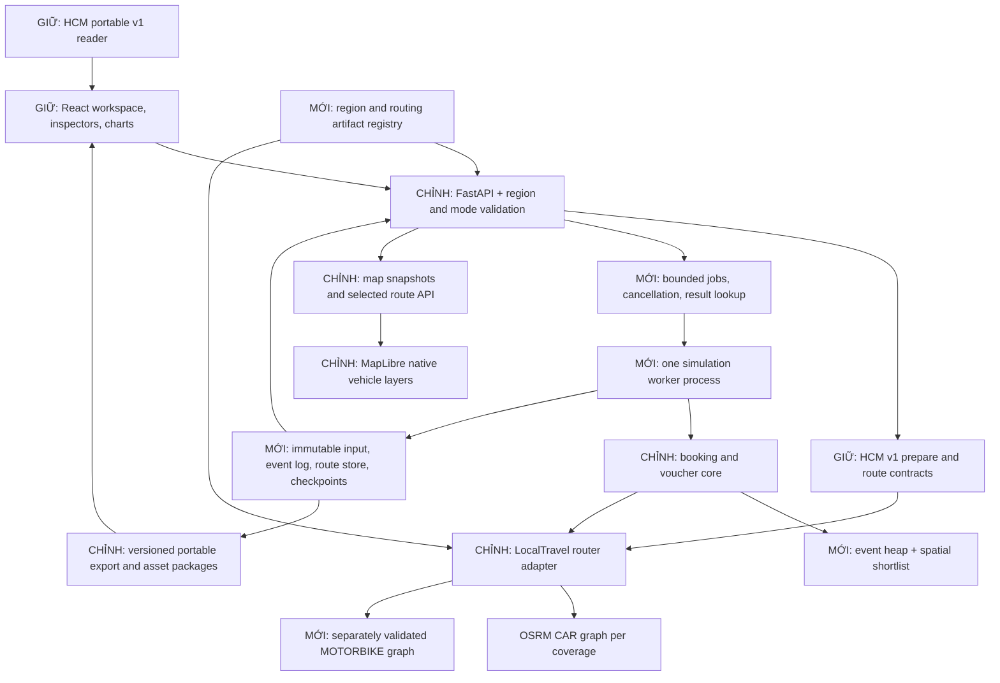

# M0 — Kiến trúc mục tiêu NVMR

Ngày: 15/10/2026. **Toàn bộ thiết kế mới trong tài liệu này là ĐỀ XUẤT, chưa triển khai.** Bằng chứng kiến trúc đang có và kiểm thử: [assessment](M0_ARCHITECTURE_ASSESSMENT.md). Trình tự thực hiện: [implementation plan](M0_IMPLEMENTATION_PLAN.md).

## 1. Quyết định tổng thể

Giữ React/TypeScript/MapLibre, FastAPI, Python domain code và OSRM MLD. Mở rộng quanh các hàm có sẵn thay vì thay engine hoặc chia microservices. Giữ đường HCM legacy hoạt động với contract hiện tại; thêm contract NVMR version mới khi region/mode/scale không còn phù hợp v1.

Đích MVP: một API process, một Python worker process, một queue có giới hạn, local artifact/job store và các OSRM process theo graph/profile. Không thêm Redis, Kafka, Kubernetes, PostGIS hoặc database phân tán khi chưa có số đo/nhu cầu. Có thể chạy small run trực tiếp qua core hiện tại trước khi job/worker hoàn chỉnh. Không cần đủ 5.000 xe để làm nghiên cứu paired tại Hà Nội.



`GIỮ` là module/cơ chế thực có; `CHỈNH` là mở rộng có chủ đích; `MỚI` chưa tồn tại. Sơ đồ không khẳng định target đã chạy.

## 2. Region configuration và dữ liệu

### 2.1. Mô hình tối thiểu

Một `RegionConfig` được resolve trên server từ registry có allowlist. Các ID gợi ý: `hcm-center` cho legacy; `nvmr-hanoi-core` cho pilot; `nvmr` khi đã có coverage miền Bắc được kiểm chứng. ID là study area ổn định, không suy ra trực tiếp từ tên tỉnh.

| Nhóm field đề xuất | Ý nghĩa |
|---|---|
| `id`, `configVersion`, `label`, `timezone` | Region identity; dùng Asia/Ho_Chi_Minh cho nhãn thời gian, simulation vẫn seconds từ run start |
| `displayBbox`, `initialViewport`, `operatingAreaRef` | Bản đồ và vùng được phép tạo xe/requests; bbox không thay polygon admission khi study area cần polygon |
| `routingCoverageRef`, `renderManifestRef` | Coverage định tuyến có buffer và assets hiển thị; không bắt mọi route nằm trong viewport |
| `demandZonesRef`, `vehicleSpawnRef`, `candidateVersion` | Sampling/weights/provenance độc lập từ bản đồ render |
| `routingByMode.CAR/MOTORBIKE` | Tham chiếu service + graph/profile artifact đã xác minh; mode chưa ready thì unavailable rõ ràng |
| `boundarySources` | Tên/aliases lịch sử, semantics phạm vi, relation ID/version nếu có, snapshot date, polygon hash/license |

Server giữ đường dẫn nội bộ và endpoint; frontend chỉ nhận public metadata, capability/readiness và asset references an toàn. Không nhận arbitrary filesystem path/OSRM URL từ experiment JSON. Mọi point là WGS84 `[longitude,latitude]`; distance m, duration s, money integer VND.

Tổ chức mới dự kiến (tên minh họa, không phải artifacts đã có):

```text
config/regions/{regionId}.json
config/routing-services.json
data/regions/{regionId}/{datasetVersion}/
  source-manifest.json
  extracted/coverage.osm.pbf
  render/manifest.json + five GeoJSON layers (or tiles later)
  demand/candidates.json + zones.json
  routing/car/{profileVersion}/manifest.json + graph files
  routing/motorbike/{profileVersion}/manifest.json + graph files
```

Giữ resolver cho `config/region.json`, `data/processed/render` và `data/routing/hcm-center.*` của HCM; không tự move/overwrite chúng. CLI mới dùng explicit region/profile/output resolution; reuse chỉ khi content/config matches và `.incomplete` không tồn tại. Khi đổi region, abort run/request cũ, clear lựa chọn, resolve đúng assets và fit viewport một lần; không refit mỗi tick. Artifact imported giữ region của chính nó, không bị region selector đang mở diễn giải lại.

### 2.2. Phạm vi miền Bắc

M1 chọn một technical coverage Hà Nội nhỏ, hợp lý cho route vòng và end-to-end pilot; **bbox/polygon cụ thể còn cần xác định từ dữ liệu**, không ghi tọa độ giả vào config ready. Về sau mở rộng Bắc Ninh, Hưng Yên, Thái Nguyên, Phú Thọ, Ninh Bình và Hải Dương trước đây bằng manifest study area có version. Có thể dùng một graph miền Bắc được buffer đủ và nhiều demand subzones; không cần một router/tỉnh. Các route liên tỉnh không bị cắt do ranh giới demand zone.

Tên tỉnh hiện tại và phạm vi trước đây có thể khác sau sắp xếp năm 2025; [nguồn Chính phủ](https://xaydungchinhsach.chinhphu.vn/chi-tiet-34-don-vi-hanh-chinh-cap-tinh-tu-12-6-2025-119250612141845533.htm) cho thấy Hải Dương trước đây nhập vào Hải Phòng, còn một số tên tỉnh khác bao phủ phạm vi sáp nhập. Phải ghi rõ yêu cầu nghiên cứu dùng phạm vi cũ hay mới, đối chiếu snapshot/relation/polygon OSM; không suy ra membership từ `name` hoặc geocoder text. M0 chưa kiểm chứng các OSM relation đó.

Tách `operatingArea` (sinh nhu cầu/xe), `routingCoverage` (đường có thể đi vòng), `renderCoverage` (những gì người dùng thấy) và viewport. Legacy HCM giữ điều kiện route nằm trong display để không đổi behavior v1; NVMR có coverage validation riêng, thông báo khi selected route đi ngoài basemap đã tải.

## 3. Vehicle/service model

Không tạo class hierarchy cho từng loại xe. Thêm field và config rõ ràng vào các model mới, dùng chung lifecycle/dispatcher.

| Entity mới/được mở rộng | Fields tối thiểu |
|---|---|
| `Vehicle` | `id`, `vehicleType: CAR|MOTORBIKE`, `initialPosition`, `onlineScheduleRef`, `regionId`; runtime `availability`, `serviceState`, active assignment, position/leg reference |
| `ModeConfig` | Fare, capacity giả định nếu dùng, router artifact ref, snap threshold và behavior parameters theo mode; không suy speed từ icon |
| `PotentialRequest` | Stable ID/passenger ID, request time, OD/zone, mode availability, shared latent preference/draw references |
| `Booking` | `requestedServiceType`, decision record, request time/OD; service type chỉ có sau mode choice hoặc user chọn rõ |
| `Trip/Assignment` | `vehicleId`, `vehicleType`, `serviceType`, pickup/trip route refs, profile/graph identity, timing và failure reason |
| Map projection | Stable vehicle ID, type, state, point/heading, active booking/route ref, sim time và sequence; không gửi toàn bộ geometry trong mỗi tick |

MVP yêu cầu booking loại nào thì dispatch xe đúng loại đó; không auto đổi CAR↔MOTORBIKE khi thiếu xe. Cross-mode fallback, nếu nghiên cứu sau này cần, là policy/model version riêng với decision trace. Tại điểm đã snap đúng mode mới cho phép stationary pickup null; một snap car không tự hợp lệ cho motorbike.

Mục tiêu đội xe 2.000 CAR + 3.000 MOTORBIKE là capacity cần benchmark, không phải default moving count. Có thể nhiều xe xuất phát cùng depot/anchor; không duy trì ràng buộc số anchor ≥ số xe của demo cũ trong v2.

### State accounting

```text
TOTAL_FLEET = OFFLINE + ONLINE
ONLINE = IDLE + ASSIGNED + ON_TRIP             (MVP không có reposition state)
ASSIGNED = đã giữ xe, đang tới pickup
ON_TRIP = đã pickup, đang chở khách
```

`ONLINE` là membership tổng hợp, không cộng thêm như một trạng thái cùng cấp với IDLE. Một xe chỉ có một service state tại một thời điểm. OFFLINE không được dispatch. ASSIGNED hoặc ON_TRIP chỉ có một active booking. Schedule offline đến khi đang bận phải có policy tường minh (đề xuất: hoàn tất chuyến rồi offline, cấm nhận thêm); mọi chuyển trạng thái phát event. `moving` chỉ suy từ active leg có duration/geometry, không bằng TOTAL/ONLINE. Fleet demo v1 `scheduled/moving/completed` được giữ riêng; không dùng các tên đó làm availability operational.

## 4. Routing architecture và kiểm chứng motorbike

Giữ `LocalTravel` interface nearest/table/route và validation trong `calculate_route`; resolve service theo `(regionId,vehicleType,artifactVersion)` từ registry. Một process OSRM phục vụ một graph/profile đã dựng; các region có thể tham chiếu chung graph coverage, hai mode dùng artifacts riêng. Chỉ đổi `/driving` thành `/motorbike` không thay graph: profile được chọn lúc extract theo [OSRM API documentation](https://project-osrm.org/docs/v5.22.0/api/?language=cURL). Không coi tên `bike` là chứng minh xe máy.

Registry entry cần profile class/vehicle assumptions, root Lua + dependency hashes, OSRM image digest/version, source PBF snapshot/hash, extract/graph checksums, build options/MLD version, coverage/snap limits, validation suite version/result. Tách **content fingerprint** khỏi URL runtime. Cache key gồm graph/profile/mode + directed endpoints + relevant routing options; không reuse car cache cho motorbike hoặc route A→B cho B→A. Giữ null ETA/reason cho unreachable; tắt mode chưa có bằng chứng, không fallback car/bicycle/đường thẳng.

M2 kiểm chứng riêng, có thể bắt đầu trên HCM graph nhỏ trước khi có dữ liệu Hà Nội:

1. Xác định loại phương tiện điện nghiên cứu (motorcycle/moped assumptions, access class) và policy xử lý tag thiếu/ambiguous. Đối chiếu quy định có thẩm quyền và đặc tính địa phương; chưa coi OSM là bằng chứng pháp lý đầy đủ.
2. Viết synthetic OSM fixtures kiểm tra access hierarchy `access/vehicle/motor_vehicle/motorcycle/moped`, direction/oneway ngoại lệ, turn restrictions, barriers, đường cao tốc/cấm loại xe, ngõ, cầu/hầm/phà, mạng disconnected và max snap. Expected allow/deny do review độc lập, không tự lấy car output làm oracle.
3. Chọn directed OD/road cases thực tế có reference mong đợi, bao gồm chỗ hai mode phải khác và chỗ nên giống. Lưu OSM way/relation IDs, snapshot, căn cứ, reviewer/uncertainty, geometry và route/service evidence. Không gán luật cho mọi highway chỉ theo class.
4. Kiểm tra route geometry đi đúng access/direction/restrictions; nearest không nhảy sang đường cấm; Table null/reachability/ETA phù hợp route cho chính OD đã snap. Test ngược chiều riêng.
5. Speed/penalties phải là giả định có version hoặc được hiệu chuẩn bằng dữ liệu có nguồn. Hợp lệ đường đi không đồng nghĩa ETA chính xác; khi chưa có time observations, nhãn ETA motorbike vẫn `model estimate, uncalibrated`.
6. Lưu báo cáo các case thất bại/unknown và phạm vi hỗ trợ; profile chỉ được quảng bá ready trong phạm vi đã kiểm tra. Chưa đủ bằng chứng thì chạy CAR pilot và giữ MOTORBIKE unavailable.

Chặn lỗi 5xx toàn dịch vụ khác với NoRoute từng OD. Health gồm process liveness và graph identity/readiness; nearest thành công không đủ chứng minh đúng dataset. Khi graph/profile thay đổi, run mới dùng version mới; run đang chạy pin version cũ hoặc fail rõ ràng, không âm thầm đổi routing giữa hai arm.

## 5. Simulation và spatial dispatch

### 5.1. Lõi deterministic từng bước

Đầu tiên tách phần pure domain ra khỏi HTTP wrappers nhưng giữ fixtures/golden semantic outputs. Thay `set times + min` bằng `heapq` priority queue `(simTime,eventPriority,stableEntityId,sequence)`; index arrivals, active assignments và pending FIFO. Không dùng wall clock hoặc thứ tự HTTP hoàn thành để quyết định simulation time/event order. Giữ same-time settlement/deadline/arrival policy v1 ở legacy; v2 công bố priority table và test riêng.

Worker nhận immutable input snapshot, chạy event engine, gọi routing adapter bounded concurrency, ghi event log/route store/checkpoint và final result. Không cập nhật mọi vehicle theo mỗi sim-second khi không có event. Idle/offline đứng yên; xe đang chạy giữ leg start/end, timestamps và geometry reference, vị trí là projection khi cần. Mỗi run/arm sở hữu state riêng; chỉ reuse immutable graph/quote evidence.

Worker process tránh CPU simulation làm nghẽn FastAPI event loop. Bắt đầu một worker và một run active, queue có quota và timeout/cancel check giữa batches; không `fire-and-forget` coroutine từ HTTP request. API jobs dự kiến `POST /api/v2/simulation-jobs`, `GET .../{id}`, `POST .../{id}/cancel`, `GET .../{id}/result`; status `queued/running/completed/failed/cancelled/interrupted`. Job identity/namespace do server cấp; canonical input hash phục vụ reproducibility, không thay thế access control. Các endpoint này **chưa tồn tại**.

Local store ghi atomically config/input manifest, progress, events/chunks/routes, checksums và final marker. Restart đánh dấu job chưa hoàn tất là interrupted; ban đầu rerun từ immutable input, chưa hứa resume chính xác. Kết quả partial không mang nhãn final. Poll progress/snapshot trước; SSE chỉ thêm nếu polling đo được quá chậm. Không cần broker ở single host MVP.

### 5.2. Spatial shortlist → pickup ETA

Uniform spatial grid ở tọa độ mét local đủ cho MVP; chưa cần H3/PostGIS. Index **IDLE+ONLINE theo mode**, cập nhật khi xe chuyển state/đến điểm trả; assignment remove ngay để tránh double allocation. Tại booking:

1. Lấy ô gần pickup theo mode, mở rộng vòng ô deterministic; shortlist ban đầu k=16 hoặc 32 (tham số cần benchmark).
2. Gọi Table directed vehicle→pickup trong batch có giới hạn kích thước/URL phù hợp OSRM config thực tế. Khoảng cách địa lý chỉ để shortlist, không giả làm ETA/route.
3. Sort `(Table ETA,vehicleId)`; xác nhận full pickup route, continuity và actual predicted pickup deadline trước assignment. Route geometry trip/pickup được lưu cho simulation, map chỉ tải geometry selection.
4. Không có candidate khả thi thì mở rộng k/radius trong query budget. Trước khi kết luận unserved, policy quy định exhaust idle set trong phạm vi đã cấu hình hoặc ghi `SEARCH_BUDGET_EXHAUSTED`; không gọi hết ngân sách tìm kiếm là `NO_VEHICLE`/`NOROUTE`.
5. Pending retry khi có xe release hoặc thời điểm retry đã quy định; cancellation/outage giữ failure code. Parallel route results phải commit theo candidate/event order cố định.

Đây là heuristic khi chỉ xét shortlist; không cam kết global minimum pickup ETA. Benchmark một sample against exhaustive all-idle Table oracle, ghi winner recall, ETA regret, miss-feasible/deadline difference và query savings. Báo cáo sensitivity theo k, geography/mode và fleet load. Ghi dispatch policy/version trong experiment để thay shortlist không bị coi là voucher effect.

## 6. Map data flow và UI

Giữ workspace/inspector/MapLibre instance, thay vehicle render path cho v2. Một GeoJSON point source mỗi mode (đơn giản cho filter/count) hoặc một source có clusterProperties đếm theo type; chọn sau benchmark. Dùng stable feature ID, properties tối thiểu type/state, native circle/symbol layers. Zoom thấp cluster/count theo type, zoom cao individual symbols + heading; màu type đi cùng icon, màu/state trong inspector hoặc outline để tránh một màu mang hai ý nghĩa không rõ.

Tận dụng `MapClusterLayer` hiện có nhưng thích ứng font `Geist` local, filters, selection và stable IDs; count text mặc định Open Sans chưa phù hợp asset style local. Không sửa toàn bộ generic map wrapper để làm product flow mới. Cluster click zoom tới expansion; point click chọn vehicle; inspector yêu cầu active route/details. Chỉ 1–2 selected route legs hiện, bỏ background route/xe trong v2. Giữ DOM marker cho selection/endpoints nhỏ nếu hữu ích.

Map snapshot mới: `runId,armId,sequence,simTime,regionId,counts,vehicles[]`; vehicle gồm point/type/state/heading/routeRef. Client bỏ snapshot cũ, phát hiện sequence gap và xin full snapshot; đổi run/arm hủy request cũ. Playback đã lưu có thể project local từ checkpoints; live worker là authority, frontend không tự dispatch/đổi KPI. Snapshot lag phải hiển thị thời gian thật của snapshot, không làm như đã có state mới.

Khởi đầu cập nhật positions khoảng 5–10 Hz, UI stats 1–2 Hz, selected animation dùng RAF trên route đã lưu; các tần số là **giả thuyết cần đo**. Coalesce updates, chỉ một request/source update đang chờ; slow client bỏ intermediate visual snapshots nhưng không bỏ domain events. Dùng `setData` cho prototype và đo chi phí; cân nhắc `updateData` khi mỗi feature có ID duy nhất. [MapLibre GeoJSONSource API](https://maplibre.org/maplibre-gl-js/docs/API/classes/GeoJSONSource/) yêu cầu unique IDs cho diff updates; [large-data guide](https://maplibre.org/maplibre-gl-js/docs/guides/large-data/) đề xuất clustering/giảm tải dữ liệu. Không suy từ tài liệu thư viện rằng ứng dụng đã đạt FPS mục tiêu.

Tách chart subscriptions khỏi vehicle update; cache cumulative segment lengths và indexes thay scan mọi assignment/route mỗi frame. Chỉ tải basemap coverage cần thiết; Hà Nội nhỏ có thể giữ GeoJSON. Nếu parse/transfer/RAM đo được vượt giới hạn, chuyển static basemap sang local vector tiles/PMTiles có manifest; không thêm tile server công cộng mặc định. Kiểm tra license/attribution, worker/CSP/base-path/offline assets ở build thực.

## 7. Voucher experiment và tái lập

### 7.1. Thiết kế khoa học v2

Giữ v1 nguyên vẹn để tái hiện HCM. V2 tạo **potential opportunity universe chung**, initial fleet/online schedules chung, seed và routing snapshot chung. Mỗi arm có state xe/pending/ledger/choice riêng. Voucher tác động booking/no-book và mode choice; arm outcomes được phép khác booking count, mode mix, dispatch/wait/completion, budget exhaustion và utilization.

Choice model tối thiểu đề xuất: categorical alternatives `NO_BOOK, CAR, MOTORBIKE`; tiện ích theo fare sau voucher, anticipated wait, latent preference, availability và OD/zone, dùng softmax với outside option. Ban đầu chỉ price + mode constants nếu chưa đủ dữ liệu wait; không thêm hệ số ước lượng giả. Đây là giả định nghiên cứu có version, **không phải mô hình đã hiệu chuẩn**. Khi thêm wait feedback, quote/ETA là expected state tại thời điểm decision của arm, không dùng actual future wait/completion làm nguyên nhân của decision.

Random streams mới keyed bởi `(modelVersion,contentDatasetId,seed,opportunityId,drawPurpose[,mode])`, ví dụ arrivals, OD, latent mode taste và choice shock; key không chứa arm, voucher amount hoặc thứ tự processing. Các alternatives dùng shared latent draws/utility shocks với cách coupling công bố. Khi biến config thay population, phải ghi estimand/coupling thay vì tuyên bố input vẫn giống. Không lấy số booking đã accept của Baseline làm population Treatment. Nếu nghiên cứu induced demand vượt universe ban đầu, sinh candidate opportunities chung đủ rộng hoặc potential process chung trước policy; không append hành khách treatment-only từ một hằng số uplift.

Với budget/routing/availability khác nhau nội sinh, hai arm vẫn hợp lệ; giữ common exogenous population và draw, không ép same booking set. Shared cache chỉ dùng dữ liệu immutable có identity; không share state/dispatch decisions. Tests gồm zero-policy parity, arm-order reversal, repeat seed, alternative ordering ổn định, unreachable one-mode, rejected/no subsidy, terminal release và negative/zero incremental completion.

### 7.2. KPI và provenance

Giữ các định nghĩa v1 khi đọc artifact cũ. V2 ghi numerator/denominator/window trong metadata; thêm mode/zone breakdown, offered/accepted/assigned/picked/completed/unserved/rejected, reasons và mode switches/induced bookings từ paired identity. So sánh tổng và theo mode để tránh tăng MOTORBIKE bị hiểu nhầm là tăng tổng demand. Dùng một arrival horizon chung và common final drain time; nếu thêm fixed-cutoff KPI, ghi incomplete/censored riêng, không trộn với drain-to-terminal.

Phân biệt request→assignment wait, assignment→pickup ETA và request→pickup wait; báo tỷ lệ served/coverage với mean/p50/p95 khi đủ mẫu. Utilization xuất ít nhất occupied vehicle-seconds và pickup+occupied busy-seconds; denominators all-fleet-time và online-time được đặt tên rõ. Ledger theo mode/campaign vẫn `total=available+reserved+spent`; tiền chỉ settle khi completion, không settle incomplete ở cutoff.

`incrementalVoucherCost = spentTreatment - spentBaseline`; v1 Baseline=0. `CPIC=incrementalVoucherCost/Δcompleted` khi Δcompleted>0, ngược lại null kèm reason. Chỉ thêm operating cost/net contribution nếu có cost assumptions/sources và sensitivity; gross fare/subsidy không tự thành ROI/lợi nhuận. Spatial demand plots tính từ accepted/served trong mỗi zone kèm population exposure, không chỉ vẽ xe và gọi đó là demand shift.

Run manifest mới ghi schema/model/demand/choice/fare/dispatch/KPI versions, code revision + dirty-source identity khi cần, config canonical hash, seed/key scheme, immutable potential+fleet hashes, dataset snapshot/hash, boundaries/zone weights, graph/profile/dependencies/image hashes, routing options và quote/route evidence refs. Runtime URL/machine/time/preparation/cache telemetry là execution metadata riêng, không ảnh hưởng common random inputs. Semantic rerun comparison bỏ timestamps/latency/cache counters; artifact content checksum dùng đúng canonical implementation của version, không tự thay JS bằng Python float serialization.

### 7.3. Replay/export migration

`gsm-voucher-experiment/v1` và `gsm-replay-assets/v1` tiếp tục dùng decoder/validator/canonicalization cũ, model versions và giới hạn cũ. V2 có schema riêng cho region/mode/route references, chunks/checkpoints và asset manifest theo region; tên cuối cùng chốt lúc M2/M5 triển khai. Reader dispatch theo version; unknown version báo lỗi rõ. Không nới validator v1 để đọc model mới như v1, không auto gán MOTORBIKE cho legacy car.

Adapter UI có thể tạo view model chung từ v1/v2 nhưng không mutate payload/hash hoặc tính lại kết quả v1 bằng model v2. Portable export phải đủ routing geometry/metrics đã dùng để Saved chạy không OSRM; route-on-click của Saved đọc route store local, không gọi router hiện tại. Large run dùng chunked package có manifest/checksum/bounds mới thay vì nhét 5.000 xe vào giới hạn 12 MiB v1. Legacy raw JSON có explicit conversion chỉ khi nguồn/versions đủ; không sửa artifact người dùng tại chỗ.

## 8. Deployment tối thiểu

Dev giai đoạn đầu giữ host Python/Node và Docker OSRM. M7 mới thêm cấu hình Compose (nếu có lợi) cho API, worker và router CAR/MOTORBIKE; graph read-only mounts theo manifest, jobs/results writable volume riêng. Render/replay assets phục vụ cùng origin với frontend; reverse proxy `/api`, job request trả nhanh để không giữ HTTP trong lúc mô phỏng. OSRM private/loopback, không mở cổng public mặc định.

Loopback-only URL validator hiện tại giữ nguyên cho legacy; môi trường container mới có registry endpoint allowlist do operator quản lý. Không nhận endpoint/network scope từ file import. Pin images/dependencies, verify graph/render hashes một lần khi startup/offline audit, health/readiness theo graph identity. Preprocessing chạy offline, không build graph lúc API boot. Giữ backup artifact version cũ và có thể rollback config mà không rebuild/overwrite HCM.

Một machine trước, cấu hình CPU/RAM/disk quota/worker concurrency từ benchmark. Log structured run/arm/entity IDs, routing counts/latencies/failures, job interruption/cancellation; hạn chế lưu route/request quá mức. Retention explicit cho jobs/results, không xóa user import/evidence tự động. Nếu thực sự cần nhiều user/host, mới bổ sung authentication, durable shared queue/DB theo nhu cầu đo được.

## 9. Trade-off và điều chưa chốt

| Quyết định đề xuất | Lý do / chi phí |
|---|---|
| Preserve legacy HCM adapters + v2 domain | Giảm regression/replay break; thêm hai đường đọc cần contract fixtures |
| Một worker process trước | CPU isolation và cancellation rõ; chưa HA/distributed resume |
| Spatial grid + shortlist + oracle sample | Đơn giản, giảm Table load; có sai lệch shortlist phải đo và ghi provenance |
| Separate graphs/mode, shared regional coverage khi phù hợp | Tránh profile giả; tăng disk/RAM preprocessing và service count theo artifact thực cần |
| Native map layers + selected routes | Giảm DOM/geometry tải; cần browser/GPU QA và stable feature IDs |
| Immutable run artifacts + local store | Dễ tái lập/di chuyển; chưa multi-user durable database |
| Small Hanoi experiment trước scale tối đa | Sớm kiểm tra khoa học end-to-end; không chứng minh capacity 5.000 |

Chưa chốt trong M0: exact Hanoi/NVMR polygons và OSM IDs, motorbike legal/access/speed assumptions, shortlist k/cell size, SLO/resource budget máy chủ, geometry package v2 và có cần vector tiles hay không. Những điểm này có thí nghiệm/đo đạc cụ thể trong implementation plan, không trở thành thủ tục approval/ownership gate.
