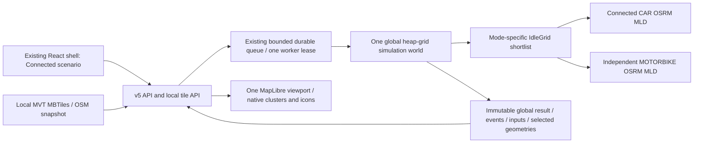

# R1b — Unified Connected Northern Vietnam Mobility Region

Technical implementation and acceptance report, 19/10/2026 (Asia/Saigon).
**In progress: R1b NO-GO / M5 NOT READY until the executed acceptance section is finalized.**
The reproducible recovery checkpoint is [R1B_PROGRESS.md](R1B_PROGRESS.md).
This implementation is synthetic research infrastructure; fleet allocations,
passenger demand and static OSRM times are not observed GSM operations.

## 1. Scope and baseline

Work began on clean `feature/nvmr-m0-architecture` at
`cd0bd26abd5c2ff83843d15a4555ba89f9d83b3f`. All changes remain unstaged in that
checkout. No branch/worktree, commit/push/merge/rebase/reset/clean, repository
`gms-voucher-research-demo` edit or historical M4 FPS milestone reopening.

The requested target supersedes independent N-region R1b-A/R1b-B expansion.
R1a still means separate Hanoi Core and Bac Ninh Core execution/routing contexts
inside a v4 envelope. No historical report has been rewritten to imply R1a had
cross-province dispatch or a continuous regional road graph.

## 2. Architecture before and after

| Axis | Preserved R1a v4 | Connected v5 |
|---|---|---|
| Engine | One execution per technical region, then aggregation | One invocation of the existing heap event engine over the whole connected world |
| Fleet/dispatch | Region/mode partition | One global fleet; spatial shortlist partitions by mode only |
| Demand | Independent generated stream per region | One independently configured global demand stream with stable passenger IDs |
| Routing | Separate local graph per region/mode | One continuous CAR graph, one independent MOTORBIKE graph |
| Clock | Common playback origin after separate runs | One event queue, simulation clock and global snapshot |
| Map | Overview then one region GeoJSON drill-down | One MapLibre instance, viewport MVT requests from offline MBTiles |
| Zone role | Execution and routing isolation | Input distribution, display filtering and explicit KPI attribution |
| Persistence | v4 regional collections | Versioned v5 immutable global inputs/events/timelines/routes/outcomes/provenance |

The existing `IdleGrid` visits occupied spatial cells and submits bounded candidate
batches, never a full-fleet Table per booking. Dispatch uses route/Table ETA and
retains explicit NoRoute/NoSegment, timeouts and unavailable-service errors.
The existing first-feasible expansion heuristic is retained and disclosed; it is
not a claim of globally optimal ETA across every vehicle. No candidate is excluded
because its technical home/current zone differs from the passenger's zone.

## 3. Source and geographic coverage

Source identity verified against the actual local file, with no replacement
download: `data/raw/vietnam-latest.osm.pbf`, 330,248,138 bytes, timestamp
`2026-10-09T20:21:04Z`, SHA-256
`2fbd2ee6b4dc151eecf04fa6823cddf584b47423e190118b10fce8b6115e9d8a`.

| Coverage | WGS84 `[west,south,east,north]` | Meaning |
|---|---|---|
| Map / default viewport | `[104.35,20.06,107.25,22.85]` | Continuous rectangle including surrounding localities |
| Routing | `[104.25,20.05,107.35,22.95]` | Buffered rectangle for road detours; south edge20.05 after offshore extent audit |
| Operating | Five disjoint versioned technical rectangles in `config/connected-nvmr.json` | Synthetic fleet/demand sampling; not official boundaries |
| Administrative labels | Hanoi/Bac Ninh/Hung Yen/Phu Tho/Thai Nguyen research labels | No verified official-polygon membership claim |

The intended map coverage includes all five post-2025 merged provinces; the
checked geographic evidence and its limits are recorded in [GIS report](R1B_CONNECTED_GIS.md).
The merger composition was checked against the [Government administrative-unit
summary](https://xaydungchinhsach.chinhphu.vn/chi-tiet-34-don-vi-hanh-chinh-cap-tinh-tu-12-6-2025-119250612141845533.htm):
Bac Ninh includes former Bac Giang; Hung Yen includes former Thai Binh; Phu Tho
includes former Vinh Phuc and Hoa Binh; Thai Nguyen includes former Bac Kan.
This source verifies the names/composition, while the local PBF relation audit
supplies the bounding extents. It does not certify OSM geometry as legal borders.
Neighboring provinces inside the map rectangle do not become research zones.
Initial membership is half-open technical-zone lookup; moving vehicles outside
those rectangles remain in the global world and are counted under
`outside-operating-zones`. This approximation is visible in UI/config/provenance.

Extract SHA-256:
`3243998cec519953323d369e4b569631edc7bef9a4fd4765c7b1e761c22a11f2`.
Executed extract:16,081,232 nodes /1,719,773 ways /10,135 relations; check-refs
zero missing node references. Detailed identities/resources are immutable local
manifests under `data/regions/nvmr-connected/`.

## 4. Offline basemap and independent routing

New isolated namespace: `data/regions/nvmr-connected/`. The map pipeline builds
MVT MBTiles with streets, water, green and places, zoom6–13 with zoom-dependent
detail. API translates XYZ viewport tiles to TMS archive rows, sends gzip when
stored compressed and performs read-only SQLite access. Packaged local font
files are reused; there is no external basemap/glyph CDN, public OSRM or runtime
Overpass. An unavailable/incomplete/mismatched map manifest produces explicit
readiness failure. It never substitutes region-wide GeoJSON or invented roads.

CAR uses `/opt/car.lua`; MOTORBIKE uses existing `profiles/motorbike.lua` and
its documented electric-motorcycle assumptions, independent profile and graph.
Connected services use loopback5005/5006 and pin graph/source/extract/profile
identities. Generated profile restriction evidence and real local OD validation
have separate scopes; OSM static models are not live traffic/legal signage proof.

Build/reuse is write-once with `.incomplete` markers, checksums, metadata and
resource guards. Only one heavy GIS stage runs at a time under a process lock.
After measuring extraction pressure, fresh extraction now requires6GiB available
physical and commit headroom; other heavy stages retain the2GiB guard and verified
extract reuse does not trigger the stronger fresh-build check.
Initial CAR preprocessing was deliberately stopped under severe memory pressure;
its exit137 records our own stop, not an observed Docker OOM. Failed artifacts/logs
are preserved. Exact attempts and final status belong in the executed evidence
section, not inferred from the existence of source code.

## 5. Global fleet, demand, distribution and accounting

Default5,000 allocation is exactly:

| Technical home zone | CAR | MOTORBIKE | Total |
|---|---:|---:|---:|
| Hanoi |1,600|2,400|4,000|
| Bac Ninh |100|150|250|
| Hung Yen |100|150|250|
| Phu Tho |100|150|250|
| Thai Nguyen |100|150|250|
| Total |2,000|3,000|5,000|

Largest remainders conserve each global mode total deterministically at other
sizes; custom exact integer allocations are validated before enqueue. Fleet
weights are a preset rather than an engine dispatch rule. Demand defaults equal
zone weights and independent CAR fraction/OD fraction; changing fleet allocation
does not secretly change passenger geography. Random draws are identity-keyed
SHA-256 namespaces, stable under configuration canonicalization.

Road-derived vertices are grouped into occupied spatial cells and sampled
round-robin with deterministic ordering. Mode-specific snapped catalogs and a
global coordinate occupancy cap avoid mass resnapping to a few depots; insufficient
anchors fail explicitly. Configuration controls cell size, maximum coordinate
occupancy and nearest-neighbor diagnostic sampling. No runtime redistribution
forces vehicles apart after natural dispatch movement.

Initial vehicles carry global unique IDs and home zones. Snapshot current zones
come from persisted geometry projection. Quality records include zone/mode
counts, unique positions, duplicates, occupied/crowded cells and sampled nearest
neighbor distances. Geographic diagnostic distances do not replace routed ETA.
The diagnostic flags cells with more than50 vehicles and defaults to128 sampled
vehicles for nearest-neighbor calculations against the full initial fleet. These
are transparent technical diagnostics, not calibrated urban congestion limits.

Global and zone KPIs retain raw numerators/denominators. Demand/wait belongs to
requested pickup zone; fleet/utilization belongs to immutable home zone. Cross-zone
assignment therefore does not double count a vehicle or force pickup-zone
utilization semantics. Means and fractions are recomputed from sums, not averages
of zone averages. Snapshot counts reconcile all vehicles across current zones,
including outside-zone travel.

## 6. API, durable execution and replay

[Strict v5 contract](../../contracts/nvmr/CONNECTED_V1.md) and generated scenario
JSON schema document all request fields. `/api/v5/simulation/jobs` mirrors durable
create/status/cancel/result/snapshot/selected-vehicle/booking/route operations.
v3/v4 reject v5 identities; v5 rejects historical IDs. There is one shared bounded
queue/worker lease; API import starts no worker. Admission uses aggregate inputs
and existing workload policy, with a second check in the worker.

Publication retains configuration, seeds, world ID, initial inputs, distribution,
routing identities, events, timelines, outcomes, chosen geometries and provenance.
Atomic COMPLETED status follows final result/event writes. Cancellation is
terminal even if an executor returns late. Worker restart records abandoned work
INTERRUPTED; explicit retry creates a distinct job. This is recovery by retained
inputs and rerun, not instruction-level crash resume.

Completed results, snapshots and selected geometry reopen without OSRM. A fresh
browser still needs local API/store/map assets. Route-on-demand means only the
selected geometry is downloaded to the UI, never every vehicle's full route.

## 7. Frontend and historical compatibility

Connected scenario is reachable through the existing simulation selector and URL
`?runtime=simulation&scenario=connected`. One global viewport/camera and all global
snapshot vehicles share existing native M4 clusters/icons/state badges and S1
journey rendering. Zone/mode filtering changes display only. Global search clears
filters and opens the inspector; pickup/trip remain distinct dashed/solid legs.
Play/pause/seek/reset/reopen share one clock. Strict response validation checks
global/zone/state/movement conservation and immutable routing identities.

Map readiness, map tile/WebGL failure, API error, router error and job terminal
state remain separate. Explicit retry reloads map readiness. Abort/epoch guards
protect seek/run/selection changes; a lost create POST is never repeated silently.
UI labels disclose technical zones and synthetic inputs.

HCM Single Trip/Fleet/Booking/Voucher/Saved Replay, Hanoi v3 and regional v4 paths
remain present with unchanged data/graph/model semantics. Actual regression counts
and browser journeys are recorded below; source preservation alone is not a claim
of live compatibility PASS. M4 FPS investigation is not reopened.

## 8. M5 extension readiness boundary

Prepared input/result already retains stable potential passenger IDs, independent
fleet/demand randomness, routing identities and separate immutable world state.
M5 can add `NO_BOOK/CAR/MOTORBIKE`, paired baseline/treatment behavior, voucher
policy/budget/ledger and incremental outcomes over those inputs. R1b adds interface
metadata and auditable additive metrics; it does not implement a calibrated choice
model, voucher effects, customer preference or commercial assumptions.

M5 READY requires executed connected routing, global simulation, persisted replay,
basic UI and compatibility evidence. FPS optimization/production deployment is
not a gate. Missing real graphs or live integration is a gate, regardless of how
many fixture tests pass.

## 9. Executed acceptance and limitations

**Acceptance is still partial while native tiles and live routing finish.**
Executed source checks at the recovery checkpoint:

| Check | Actual result | Evidence |
|---|---|---|
| Backend, artifact-free |315 PASS /6 SKIP /1 deprecation warning,89.76s |`build/r1b-backend-tests-final.txt`; subsequent GIS-only additions require the final combined collection |
| Frontend full suite after browser fix |209 PASS /26 files,152.31s |`build/r1b-frontend-tests-final.txt`; concurrent native encoding, not a frontend performance benchmark |
| Browser-discovered initial map failure regression |Fixed;6 focused health tests PASS, actual browser error now visible |`build/r1b-map-health-regression.txt`, `r1b-evidence/browser/map-not-ready.jpg` |
| Typecheck / production build |PASS; chunk-size warning in build |`build/r1b-typecheck.txt`, `build/r1b-build.txt` |
| Lint |Exit0;0 errors /53 warnings including7 connected warnings |`build/r1b-lint.txt`; warning-free quality is not claimed |
| Saved Replay package |PASS9 assets and artifact digest; browser exports NOT RUN |`build/r1b-replay-verification.txt` |
| Actual protected HCM source/map bytes |1 real-data test PASS |`build/r1b-hcm-protected-inputs.txt`; does not require or establish live HCM routing |
| Actual historical v3/v4 persisted replay |PASS,5,000 vehicles each; snapshots0/middle/end, selected booking/routes, v5 namespace rejection, unchanged result hashes |`r1b-evidence/historical-replay.json`; all local router ports were offline |

The six artifact-free skips are explicit real-data opt-ins, not passes. One of
those tests was subsequently executed separately against the actual historical
protected files. Historical R1a/M3/M4 measurements remain historical.

Domain fixture benchmarks are intentionally separate from local OSRM performance.
Every size below has100 synthetic requests and explicit fixture geometry/ETA:

| Fleet | Wall seconds | Process lifetime peak RSS bytes | Encoded output bytes | Completed /unserved |
|---|---:|---:|---:|---:|
|100|2.368|54,878,208|538,028|100 /0|
|500|3.216|56,397,824|664,327|100 /0|
|1,000|3.857|58,134,528|819,575|100 /0|
|5,000|7.857|72,523,776|2,047,006|100 /0|

Evidence: `r1b-evidence/domain-benchmark.json`. These sequential scales share a
process, so RSS is a lifetime high-water mark. They prove engine/distribution/
accounting and replay conservation under the fixture, not real OSRM throughput,
road availability or browser performance.

Actual browser smoke has reached Connected through the existing main menu and
selector, checked the exact default/preset allocations, and verified Back/Forward
to Hanoi v3. An attempt with absent routing proofs correctly returned503
`CONNECTED_NOT_READY` with separate mode causes and created no job. It exposed an
initial-map error handling defect: waiting for MapLibre's `load` event suppressed
the error when failed initial tiles prevented that event. The connected health
observer now starts on map-instance creation, with READY still requiring loaded
viewport data. A rebuilt preview and browser reload show the explicit missing
manifest/503 error. This is a demonstrated new R1b fix, not an M4 FPS investigation.

The current v3 API reopened historical run `77bae3c7611849eeac7a9ab4dd375cc6`
(6,809,115bytes) and v4 reopened `370d1b3f87f4465ab7446e23b8852ae4`
(11,323,043bytes). Both retained5,000 vehicles across all sampled times and
served selected geometry while ports5000–5006 were offline. The old runs'
completion counts are historical outcomes, not new R1b throughput measurements.

Actual HCM Saved Replay browser loaded the sealed demo, verified its displayed
digest/provenance, played and sought to500s, and rendered Baseline/Treatment
analytics with routers offline. A Portable export click produced no captured
IAB download event within15s and no new console error; byte-level browser export
round trip remains NOT VERIFIED. Package/validator tests passed separately.

Real cross-province route/dispatch, live scale benchmarks, successful basemap,
selected-route playback and final GO/M5 decisions remain pending at this section's
current checkpoint. Machine-readable status is `r1b-evidence/validation-summary.json`.

## 10. Changed files and review

Connected backend: `connected_context.py`, `connected_simulation.py`,
`connected_jobs.py`, `connected_assets.py`; narrow main/store/worker dispatch
integration. Connected frontend: workspace/map/session/contract and narrow
scenario selector/map-style additions. GIS: isolated connected config/pipeline,
render/validation/dependency instructions. Acceptance: connected tests, domain
benchmark and live API audit scripts. Docs: this report/runbook/checkpoint,
GIS report, v5 contract/JSON schema, README and historical direction banners.

The final diff/status evidence must list the actual files, including new files
that plain `git diff --stat` omits. Large data, build outputs, job stores,
dependencies and secrets must remain ignored. Project Owner reviews the unstaged
change; no automatic stage/commit/push/merge is performed. Exact Windows demo and
recovery commands are in [runbook](R1B_CONNECTED_RUNBOOK.md).
