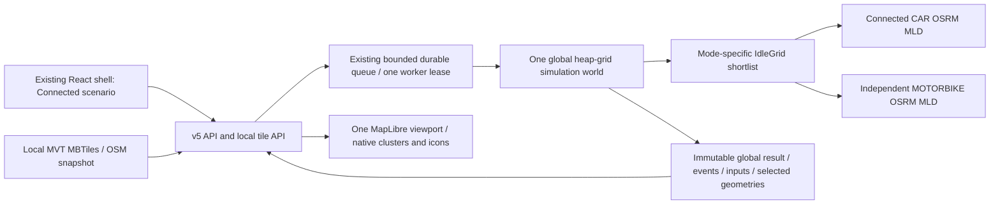

# R1b — Unified Connected Northern Vietnam Mobility Region

Technical implementation and acceptance report, 19/10/2026 (Asia/Saigon).
**R1b: CONDITIONAL GO cho hạ tầng và demo đã kiểm chứng; M5: NOT READY cho acceptance toàn bộ quy mô yêu cầu.**
Routing thật, global dispatch, immutable replay và UI cơ bản đã có bằng chứng. Chưa chứng minh được Connected live500/1.000/5.000 ổn định; guard RAM hiện chặn khởi động router. Chi tiết và điều kiện còn thiếu ở mục9–11.
The reproducible recovery checkpoint is [R1B_PROGRESS.md](R1B_PROGRESS.md).
This implementation is synthetic research infrastructure; fleet allocations,
passenger demand and static OSRM times are not observed GSM operations.

## 1. Scope and baseline

Work began on clean `feature/nvmr-m0-architecture` at
`cd0bd26abd5c2ff83843d15a4555ba89f9d83b3f`. The afternoon resume found existing
checkpoint HEAD `1f56c4958f9e4748e2f8c425ed639542a73ed363` plus six dirty files.
That checkpoint was not created by this resumed run. Current additional changes
remain unstaged. No branch/worktree, commit/push/merge/rebase/reset/clean, repository
`gms-voucher-research-demo` edit or historical M4 FPS milestone reopening.

The requested target supersedes independent N-region R1b-A/R1b-B expansion.
R1a still means separate Hanoi Core and Bac Ninh Core execution/routing contexts
inside a v4 envelope. No historical report has been rewritten to imply R1a had
cross-province dispatch or a continuous regional road graph.

## 2. Architecture before and after

| Axis | Preserved R1a v4 | Connected v5 |
|---|---|---|
| Engine | One execution per technical region, then aggregation | One invocation of the existing heap event engine over the whole connected world |
| Fleet/dispatch | Region/mode partition | One global fleet; spatial shortlist partitions by mode only |
| Demand | Independent generated stream per region | One independently configured global demand stream with stable passenger IDs |
| Routing | Separate local graph per region/mode | One continuous CAR graph, one independent MOTORBIKE graph |
| Clock | Common playback origin after separate runs | One event queue, simulation clock and global snapshot |
| Map | Overview then one region GeoJSON drill-down | One MapLibre instance, viewport MVT requests from offline MBTiles |
| Zone role | Execution and routing isolation | Input distribution, display filtering and explicit KPI attribution |
| Persistence | v4 regional collections | Versioned v5 immutable global inputs/events/timelines/routes/outcomes/provenance |

The existing `IdleGrid` visits occupied spatial cells and submits bounded candidate
batches, never a full-fleet Table per booking. Dispatch uses route/Table ETA and
retains explicit NoRoute/NoSegment, timeouts and unavailable-service errors.
The existing first-feasible expansion heuristic is retained and disclosed; it is
not a claim of globally optimal ETA across every vehicle. No candidate is excluded
because its technical home/current zone differs from the passenger's zone.

## 3. Source and geographic coverage

Source identity verified against the actual local file, with no replacement
download: `data/raw/vietnam-latest.osm.pbf`, 330,248,138 bytes, timestamp
`2026-10-09T20:21:04Z`, SHA-256
`2fbd2ee6b4dc151eecf04fa6823cddf584b47423e190118b10fce8b6115e9d8a`.

| Coverage | WGS84 `[west,south,east,north]` | Meaning |
|---|---|---|
| Map / default viewport | `[104.35,20.06,107.25,22.85]` | Continuous rectangle including surrounding localities |
| Routing | `[104.25,20.05,107.35,22.95]` | Buffered rectangle for road detours; south edge20.05 after offshore extent audit |
| Operating | Five disjoint versioned technical rectangles in `config/connected-nvmr.json` | Synthetic fleet/demand sampling; not official boundaries |
| Administrative labels | Hanoi/Bac Ninh/Hung Yen/Phu Tho/Thai Nguyen research labels | No verified official-polygon membership claim |

The intended map coverage includes all five post-2025 merged provinces; the
checked geographic evidence and its limits are recorded in [GIS report](R1B_CONNECTED_GIS.md).
The merger composition was checked against the [Government administrative-unit
summary](https://xaydungchinhsach.chinhphu.vn/chi-tiet-34-don-vi-hanh-chinh-cap-tinh-tu-12-6-2025-119250612141845533.htm):
Bac Ninh includes former Bac Giang; Hung Yen includes former Thai Binh; Phu Tho
includes former Vinh Phuc and Hoa Binh; Thai Nguyen includes former Bac Kan.
This source verifies the names/composition, while the local PBF relation audit
supplies the bounding extents. It does not certify OSM geometry as legal borders.
Neighboring provinces inside the map rectangle do not become research zones.
Initial membership is half-open technical-zone lookup; moving vehicles outside
those rectangles remain in the global world and are counted under
`outside-operating-zones`. This approximation is visible in UI/config/provenance.

Extract SHA-256:
`3243998cec519953323d369e4b569631edc7bef9a4fd4765c7b1e761c22a11f2`.
Executed extract:16,081,232 nodes /1,719,773 ways /10,135 relations; check-refs
zero missing node references. Detailed identities/resources are immutable local
manifests under `data/regions/nvmr-connected/`.

## 4. Offline basemap and independent routing

New isolated namespace: `data/regions/nvmr-connected/`. The map pipeline builds
MVT MBTiles with streets, water, green and places, zoom6–13 with zoom-dependent
detail. A separate real-geometry overview archive covers zoom0–5: default whole-region
fit can be below6 in a laptop map pane. This fixes a browser-proven blank overview
without changing the validated detailed archive/config/graphs. API translates XYZ viewport tiles to TMS archive rows, sends gzip when
stored compressed and performs read-only SQLite access. Packaged local font
files are reused; there is no external basemap/glyph CDN, public OSRM or runtime
Overpass. An unavailable/incomplete/mismatched map manifest produces explicit
readiness failure. It never substitutes region-wide GeoJSON or invented roads.

CAR uses `/opt/car.lua`; MOTORBIKE uses existing `profiles/motorbike.lua` and
its documented electric-motorcycle assumptions, independent profile and graph.
Connected services use loopback5005/5006 and pin graph/source/extract/profile
identities. Generated profile restriction evidence and real local OD validation
have separate scopes; OSM static models are not live traffic/legal signage proof.

Build/reuse is write-once with `.incomplete` markers, checksums, metadata and
resource guards. Only one heavy GIS stage runs at a time under a process lock.
After measuring extraction pressure, fresh extraction now requires6GiB available
physical and commit headroom; other heavy stages retain the2GiB guard and verified
extract reuse does not trigger the stronger fresh-build check.
Initial CAR preprocessing was deliberately stopped under severe memory pressure;
its exit137 records our own stop, not an observed Docker OOM. Failed artifacts/logs
are preserved. Exact attempts and final status belong in the executed evidence
section, not inferred from the existence of source code.

## 5. Global fleet, demand, distribution and accounting

Default5,000 allocation is exactly:

| Technical home zone | CAR | MOTORBIKE | Total |
|---|---:|---:|---:|
| Hanoi |1,600|2,400|4,000|
| Bac Ninh |100|150|250|
| Hung Yen |100|150|250|
| Phu Tho |100|150|250|
| Thai Nguyen |100|150|250|
| Total |2,000|3,000|5,000|

Largest remainders conserve each global mode total deterministically at other
sizes; custom exact integer allocations are validated before enqueue. Fleet
weights are a preset rather than an engine dispatch rule. Demand defaults equal
zone weights and independent CAR fraction/OD fraction; changing fleet allocation
does not secretly change passenger geography. Random draws are identity-keyed
SHA-256 namespaces, stable under configuration canonicalization.

Road-derived vertices are grouped into occupied spatial cells and sampled
round-robin with deterministic ordering. Mode-specific snapped catalogs and a
global coordinate occupancy cap avoid mass resnapping to a few depots; insufficient
anchors fail explicitly. Configuration controls cell size, maximum coordinate
occupancy and nearest-neighbor diagnostic sampling. No runtime redistribution
forces vehicles apart after natural dispatch movement.

Initial vehicles carry global unique IDs and home zones. Snapshot current zones
come from persisted geometry projection. Quality records include zone/mode
counts, unique positions, duplicates, occupied/crowded cells and sampled nearest
neighbor distances. Geographic diagnostic distances do not replace routed ETA.
The diagnostic flags cells with more than50 vehicles and defaults to128 sampled
vehicles for nearest-neighbor calculations against the full initial fleet. These
are transparent technical diagnostics, not calibrated urban congestion limits.

Global and zone KPIs retain raw numerators/denominators. Demand/wait belongs to
requested pickup zone; fleet/utilization belongs to immutable home zone. Cross-zone
assignment therefore does not double count a vehicle or force pickup-zone
utilization semantics. Means and fractions are recomputed from sums, not averages
of zone averages. Snapshot counts reconcile all vehicles across current zones,
including outside-zone travel.

## 6. API, durable execution and replay

[Strict v5 contract](../../contracts/nvmr/CONNECTED_V1.md) and generated scenario
JSON schema document all request fields. `/api/v5/simulation/jobs` mirrors durable
create/status/cancel/result/snapshot/selected-vehicle/booking/route operations.
v3/v4 reject v5 identities; v5 rejects historical IDs. There is one shared bounded
queue/worker lease; API import starts no worker. Admission uses aggregate inputs
and existing workload policy, with a second check in the worker.

Publication retains configuration, seeds, world ID, initial inputs, distribution,
routing identities, events, timelines, outcomes, chosen geometries and provenance.
Atomic COMPLETED status follows final result/event writes. Cancellation is
terminal even if an executor returns late. Worker restart records abandoned work
INTERRUPTED; explicit retry creates a distinct job. This is recovery by retained
inputs and rerun, not instruction-level crash resume.

Completed results, snapshots and selected geometry reopen without OSRM. A fresh
browser still needs local API/store/map assets. Route-on-demand means only the
selected geometry is downloaded to the UI, never every vehicle's full route.

## 7. Frontend and historical compatibility

Connected scenario is reachable through the existing simulation selector and URL
`?runtime=simulation&scenario=connected`. One global viewport/camera and all global
snapshot vehicles share existing native M4 clusters/icons/state badges and S1
journey rendering. Zone/mode filtering changes display only. Global search clears
filters and opens the inspector; pickup/trip remain distinct dashed/solid legs.
Play/pause/seek/reset/reopen share one clock. Strict response validation checks
global/zone/state/movement conservation and immutable routing identities.

Map readiness, map tile/WebGL failure, API error, router error and job terminal
state remain separate. Explicit retry reloads map readiness. Abort/epoch guards
protect seek/run/selection changes; a lost create POST is never repeated silently.
UI labels disclose technical zones and synthetic inputs.

HCM Single Trip/Fleet/Booking/Voucher/Saved Replay, Hanoi v3 and regional v4 paths
remain present with unchanged data/graph/model semantics. Actual regression counts
and browser journeys are recorded below; source preservation alone is not a claim
of live compatibility PASS. M4 FPS investigation is not reopened.

## 8. M5 extension readiness boundary

Prepared input/result already retains stable potential passenger IDs, independent
fleet/demand randomness, routing identities and separate immutable world state.
M5 can add `NO_BOOK/CAR/MOTORBIKE`, paired baseline/treatment behavior, voucher
policy/budget/ledger and incremental outcomes over those inputs. R1b adds interface
metadata and auditable additive metrics; it does not implement a calibrated choice
model, voucher effects, customer preference or commercial assumptions.

M5 READY requires executed connected routing, global simulation, persisted replay,
basic UI and compatibility evidence. FPS optimization/production deployment is
not a gate. Missing real graphs or live integration is a gate, regardless of how
many fixture tests pass.

## 9. Kiểm chứng thực tế và benchmark

Báo cáo chốt sau lượt resume chiều19/10/2026. Phân biệt kết quả thực thi, fixture và giới hạn môi trường; không suy diễn PASS từ source hoặc artifact tồn tại.

| Kiểm tra | Kết quả đã chạy | Evidence |
|---|---|---|
| Backend full regression cuối | **350 PASS /6 SKIP /1 warning**,77,38s |`r1b-evidence/checks/r1b-acceptance-backend.txt` |
| API evidence verifier mới | **6 focused PASS**,1,25s; đã nằm trong full350 |`build/r1b-resume-api-evidence-tests.txt` |
| Frontend full regression cuối | **210 PASS /26 files**,49,51s |`r1b-evidence/checks/r1b-acceptance-frontend.txt` |
| Frontend global5000 contract | **11 PASS** trong focused file, gồm1case mới5000; fixture, không phải browser5000 |`build/r1b-resume-frontend-5000-contract.txt` |
| Typecheck |PASS |`build/r1b-resume-typecheck.txt` |
| Lint |Exit0,0errors/53warnings,7connected warnings |`build/r1b-resume-lint.txt` |
| Production build |PASS, Vite1,05s; chunk-size warning |`build/r1b-resume-build.txt` |
| Replay package |PASS9assets, digest `b4a87ee371f976f12f4da28791dffc66ebeb24352c1d664bf71851eb89c27433`; browser export round-trip NOT VERIFIED |`build/r1b-resume-replay-verification.txt` |
| Source/extract/both graphs/detail+overview tiles |PASS current checksums/manifests; không rebuild phần đã hợp lệ |`r1b-evidence/gis/artifact-audit.json` |
| Real connected routing |20directed inter-zone OD/mode PASS; local, one-way/source-node, snapping/NoSegment và oracle riêng |`r1b-evidence/gis/routing/*/routing-validation.json`; xem GIS report |
| Real global dispatch |8assignments từ Bắc Ninh đến Hà Nội, gồm cảCAR/MB |`r1b-evidence/live-cross-zone.json` và audit router-off `replay-cross-zone.json` |
| Completed v5 persistence/replay/KPI |PASS100live+targetcross-zone+defaultwait all-unserved; snapshot0/mid/end và selectedroutes khi routers tắt |`r1b-evidence/replay-*.json` |
| Browser |PASS bounded100: overview, chi tiết OSM, cluster/icon, filter/search/inspector, pickup/trip, click/seek/play/pause, persistedreopen |`r1b-evidence/browser/connected-final-smoke.json` và `connected-offline-smoke.json` |

Sáu SKIP là explicit historical real-data opt-ins. Trong lượt triển khai trước resume chiều, từng bài đã chạy riêng:1protected-source/map PASS1,52s và5routing/booking/voucher/Hanoi-mode tests PASS27,59s (`build/r1b-hcm-protected-inputs.txt`, các log compatibility). Không gọi SKIP là PASS, không coi lần riêng là full-suite live rerun hiện tại. Warning backend là Starlette/httpx deprecation.

### 9.1. Benchmark domain fixture — không dùng OSRM thật

Mỗi size có100synthetic requests, fixture ETA/geometry; output và accounting thật của engine. Các scale chạy cùng process nên RSS là lifetime high-water mark, không phải peak độc lập từng scale.

| Fleet | Wall(s) | Lifetime peak RSS(bytes) | Output(bytes) | Completed/unserved |
|---|---:|---:|---:|---:|
|100|2,368|54.878.208|538.028|100/0|
|500|3,216|56.397.824|664.327|100/0|
|1.000|3,857|58.134.528|819.575|100/0|
|5.000|7,857|72.523.776|2.047.006|100/0|

`r1b-evidence/domain-benchmark.json` là proof engine/conservation/KPI/replay dưới fixture; không chứng minh throughput OSRM hoặc UI5000.

### 9.2. Benchmark inputs trên anchors đường thật — offline

`r1b-evidence/real-road-inputs.json`:100/500/1000/5000vehicles,100bookings cho mỗi size; chuẩn bị1,073/1,077/3,074/3,114s; process lifetime peak109.760.512bytes. Zero nearest/Table/Route calls; không chạy dispatch/lifecycle.

5000exact: Hà Nội4000; bốn vệ tinh250mỗi;2000CAR/3000MB;5000globalIDs và snappedpositions duy nhất,0duplicate,888occupiedcells, maximum36xe/cell,0cells>50. NN sample128againstall5000: min1,90m/median245,87m/p95=2259,67m. Đây là thống kê phân bố ban đầu, không phải khoảng cách đi đường hoặc yêu cầu khoảng cách an toàn xe. Same-seed5000repeat và demand independent of fleet size PASS. Initialinput736.875bytes, SHA `87fb4082e8e0139770deae9bc32fe59682a9ef2a64f5f9e29d063e6e0c603a34`, ignored path `build/r1b/real-road-initial-5000.json`.

### 9.3. Real local Connected OSRM execution

| Workload | Worker total/prep(s) | Completed/unserved | Output(bytes) | Trạng thái |
|---|---:|---:|---:|---|
|100xe/25requests, maxWait900 |13,762/8,552|9/16|565.311|PASS live và router-off re-audit |
|100xe/25requests, default maxWait300 |21,298|0/25|54.050|COMPLETED hợp lệ; không có selectedjourney |
|20xe Bắc Ninh/20requests Hà Nội, maxWait3600 |25,558/20,666|8/12|495.869|PASS targetedcross-zone, cả2modes |
|500xe/125requests |—|—|—|FAILED timeout/resource-pressure/interrupted attempts; chưa có successful benchmark |
|1.000xe/250requests |—|—|—|NOT RUN thành công |
|5.000xe/1.250requests |—|—|—|NOT RUN thành công |

100maxWait900 job `271d116d28f64d75a7a49b3f300d7b24`: CAR43Table/16Route/240Tablecachehits, MB72Table/18Route/168hits; total9734candidateentries trong227dispatchattempts,0searchbudgetexhaustions. Chỉ shortlist, không fullfleetTable/booking. SampledworkerRSS114.737.152/lifetimepeak116.490.240bytes. After-run OSRM CAR58,51MiB/MB60,5MiB cgroupusage; **không phải per-router peak**. Minphysical2.471.530.496/mincommit912.211.968bytes cho thấy headroom commit có lúc thấp.

Target job `e001951cb0594c979c49d6d621eaace0`:8cross-zoneassignments, CAR8Table/13Route/7hits; MB22Table/15Route/120hits và1requestfailure được ghi telemetry. SampledRSS103.575.552/lifetime115.978.240bytes, minphysical1.859.915.776/mincommit1.305.321.472. Static modeled ETAs, không phải traffic trực tiếp hay observed GSM outcomes. Timeout/error không bị chuyển thành tuyến giả.

Defaultwait300 job `5f0b15d0e1244c199397210631bbea7e` có0served là domain outcome hợp lệ với fleet thưa/nhu cầu độc lập. Verifier giờ tách invariant benchmark khỏi requiredjourneys; `--require-mode-journeys`/`--cross-zone-proof` vẫn buộc có geometry thật của cả2modes. Không tăng wait ngầm để làm đẹp số served.

Các reports `replay-live-100.json`, `replay-cross-zone.json`, `replay-live-100-default-wait.json` được audit lại với routers OFFLINE bằng API mới. Chúng ghi rõ scope audit immutable result/replay, workerRSS=null nếu không quan sát RUNNING; không gán PID cũ/reused cho run đã xong hoặc thay resource execution cũ bằng số đo replay.

### 9.4. Tài nguyên và blocker còn lại

16.948.453.376bytes physicalRAM; router guard2GiBphysical+commit,8GiBdisk giữ nguyên. Admission-only check cuối (`r1b-evidence/resume-resource-admission.json`) đo~1,09GiBphysical,~4,82GiBcommit và38,44GBdisk: **BLOCKED_RESOURCE_GUARD**, dockerps empty. Không start router, không dừng Chrome/ownerapps, không sửa Docker/WSL/pagefile hoặc nới guard. Owner chọn tiếp tục offline.

CAR/MBbuild tuần tự,2GiBcontainercap/2threads; runtime verified `--mmap=1`,1GiBcap/mode,readonly toàngraph. Mmap giảm heap/cgroupusage nhưng graph pages/pagecache/WSL vẫn tiêu tốn RAM host; số after-run thấp không chứng minh laptop luôn đủ headroom. Nativebasemap peakRSS431.554.560bytes; overview120.438.784bytes/221,667s. Có thời điểm hostphysical xuống927.346.688bytes trong giai đoạn detailtiles khi Docker boot; không tuyên bố memory margin thoải mái.

Một report500RUNNING cũ chỉ tới queuedjob ở `build/m3/jobs`, không phải `build/r1b/jobs`; đã ghi evidence và cancel đúng task-owned orphan, không bỏ job hoặc khai successful500. Failed attempts còn nguyên để audit.

## 10. Compatibility, browser và giới hạn nghiên cứu

- HCM SingleTrip/Fleet/Booking/Voucherv1/SavedReplay source/API giữ nguyên semantics; fullregression bao gồm đường cũ, actual historical real-data checks đã chạy riêng như trên.
- Fresh historical v3 run `14e1fe51d16644e3bd3f0a33bda85f35`:100xe/20requests/20completed. Freshv4 `c712c7eeb08346718e7c7706cbd8c4ed`:20xe/24requests/18completed/6unserved và4region-modejourneys; independentaudit PASS. Xem `historical-v3-live.json`, `historical-v4-live.json`.
- Actual stored v3 `77bae3c7611849eeac7a9ab4dd375cc6` vàv4 `370d1b3f87f4465ab7446e23b8852ae4`:5000xe mỗi run, snapshots0/mid/end/selectedroutes/namespace404 và immutablehash unchanged, allrouterportsOFFLINE (`historical-replay.json`). Đây là replay của run lịch sử, không phải throughput Connected mới.
- HCM SavedReplay browser play/seek500/import sealedfile/analytics PASS; Portableexportclick không có capturedIABdownload sau15s và không có newconsoleerror. Byte-level browserexport roundtrip **NOT VERIFIED**, không coi đây là productFAIL cũng không gọi PASS. Package9assets verifier riêng PASS.
- Connected browser thực tế100xe: mộtcanvas,0DOMvehiclemarkers; fullfitoverview và cluster100; BacNinhCARfilter2visible/global100; tìmHNIDxóa filter; CARASSIGNED400s/ON_TRIP800s; MBinspector/nativeclick/highzoomicon/playpause đã kiểm chứng. Chỉ selectedpickup/triproute; không render mọiroute. Chưa có browser5000Connected và không đánh giá universalFPS/Meet/production.
- Hai regression R1b mới đã sửa: initial maperror không hiện vì đợi load thất bại; whole-regionfit zoom5,46<sourceMin6 gây blankmap. Overview realOSM0–5 xử lý lỗi sau, giữ nguyên detail6–13. Ảnh blank cũ giữ làm evidence lỗi; ảnh `connected-offline-overview-fixed.jpg` mới là proof thành công.
- Operatingzones là technical rectangles, không phủ theo officialprovincepolygon; currentzone ngoài các rectangle ghi riêng. Toànmap và routingbuffer vẫn đủ rectangle đã audit, không thu hẹp coverage để tránh memory.
- Spatialfirst-feasible shortlist là heuristic có boundedbudget, không bảo đảm globalETAoptimum; waits/unserved phụ thuộc assumed inputs. Table/Route distance tolerance0,01% và limitation dữ liệu negativeNoRoute/turnoracle được nêu đầy đủ ở GIS report.
- Windows PermissionError retry95ms giữ atomicpublication/failclosed; persistentstatuslock vẫn có thể khiến worker thoát và cần lease recovery thành INTERRUPTED. Không hứa resume instruction-level; tests failure/cancel/latepublish/recovery PASS. NewConnected live cancellation còn thiếu; không lấy unit/historicalcancellation làm freshliveproof.
- Horizon là cửa sổ sinh nhu cầu, engine drains acceptedwork. M5 cần common observationhorizon trước pairedutilization; R1b chưa implement potentialNO_BOOKcohort, behavior/ledger/vouchereffect.

## 11. Quyết định và engineering handoff

**R1b: CONDITIONAL GO.** Kiến trúc Connected thực, graphs/basemap/anchors, globaldispatch/persistence/UI cơ bản và compatibility có bằng chứng. GO có giới hạn cho demo/review và phát triển source trên workload đã kiểm chứng. Chưa acceptance yêu cầu vận hành ổn định tối đa5000trên máy hiện tại.

**M5: NOT READY** cho sign-off toàn bộ research infrastructure yêu cầu trong prompt. Interface phát triển M5 đã có, nhưng thiếu successfulConnected live500/1000/5000, live cancellation và basicbrowser5000 để xác nhận vòng thực thi lớn. Đây là thiếu evidence routing/simulation ởscale, không phải gateFPS/M4/production. Không cần mở lại M4 để giải quyết phần này.

Next exact commands khi host thực sự có≥2GiBphysical+commit (không rebuild): runbook mục2serveCAR→serveMB, mục4benchmark500→1000→5000 tuần tự với outputpaths mới; giữ maxWait/seed, archive failures. Xác nhận queued/running trong đúng absoluteR1bstore; chạy livecancel và reopencompletedwithroutersoff; mở actual5000run bằng UI, kiểm conservation/filter/search/seek/selectedroute. Sau đó update decision theo bằng chứng, không sửa historical benchmark. Không cần Owner chia lại chức năng thành prompt mới; blocker là headroom môi trường hiện tại.

M5 contract/handoff: [CONNECTED_V1.md](../../contracts/nvmr/CONNECTED_V1.md), [M5_ENGINEERING_HANDOFF.md](M5_ENGINEERING_HANDOFF.md). Không hard-code preferences/vouchereffects/actualGSMdata.

Source review chia theo nhóm: backend`connected_context/simulation/jobs/assets` và narrow`main/simulation_worker/simulation_jobs`; frontend`connected-workspace/connected-map`, `connected-simulation/use-connected-simulation/map-style`, narrowselector; GIS`connected_gis/connected_gis_render/connected_overview_tiles/validate_connected_routing/connected_gis_capture`; tests/contract/config; README+currentreports+historicalsupersededbanners. Danh sách đầy đủ của deltaR1a→workingtree và deltaHEAD→workingtree lưu trong `r1b-evidence/git-review.json`; newfiles cũng được liệt kê, không chỉtrackedstat.

Không tựstage/commit/push/merge. HEADcheckpoint có sẵn được giữ nguyên. PBF/graphs/tiles/jobs/build/dependencies không được stage. ExactPowerShelldemo/reuse/review/stopreceipt ở [runbook](R1B_CONNECTED_RUNBOOK.md).
